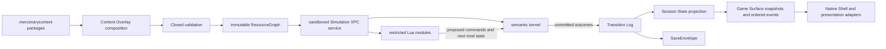

# Content and State Model v1

Status: normative

Decision ticket: [#11 — Define the content and state model](https://github.com/odogono/mercenary/issues/11)

Related decisions: [Fidelity Contract](fidelity-contract.md), [Publication Policy](publication-policy.md), [Native Simulation and Rendering Architecture](native-architecture.md), [macOS Experience Contract](macos-experience.md), [Product and Technical Implementation Specification](implementation-specification.md), [ADR 0005](adr/0005-separate-catalogue-entries-from-behavior-cases.md), [ADR 0008](adr/0008-derive-session-state-from-committed-transitions.md), and [ADR 0009](adr/0009-isolate-untrusted-lua-game-semantics.md)

## Purpose and status

This contract defines the production boundaries and relationships for Content Sets, Content Overlays, the resolved `ResourceGraph`, Lua-authored Game Semantics, Session State, the Transition Log, and native saves. It covers the complete Initial Release and creates one deliberate data-and-migration seam for *The Second City* without adding that expansion's content or assuming how its state will relate to an Initial Release session.

The contract defines semantic records and interfaces in Markdown. It does not add executable schemas, a loader, Lua, an XPC service, a state codec, or production content. Exact Reference Build content, save gates, timing values, rule parameters, and Acceptance Envelopes remain evidence-pending where the Behavior Catalogue records an uncertainty.

The words **must**, **must not**, **required**, **should**, and **may** are normative.

## Governing decisions

- A session receives exactly one immutable, fully resolved Content Set represented by one validated `ResourceGraph`.
- A Content Overlay names one exact base digest and applies explicit typed `add`, `replace`, and `remove` operations. Overlay ancestry is a single linear chain; sibling overlays are never merged by user-selected order.
- Official Game Semantics and Mods use the same restricted Lua 5.5.1 hook-and-command path over a small Swift semantic kernel.
- Sideloaded Mods are untrusted. Lua and the simulation runtime execute in a separately sandboxed XPC service with no file or network access.
- Session State is derived from an authoritative Transition Log of committed outcomes. Historical Lua rules are not re-executed to load a save.
- Saves bind to the exact resolved content, Lua, host ABI, property schema, and transition schema environment that produced them. Moving to another environment requires an explicit migration.
- Only maintainer-designated exact official Content Set digests are eligible for Fidelity Contract conformance. A sideloaded overlay always marks the session as modded and non-conformant.

## Domain boundaries

The `ResourceGraph` owns immutable definitions. The sandboxed simulation service owns all mutable Game Semantics. The Native Shell owns package import, user consent, documents, ten global quick slots, atomic file movement, and safe diagnostics; it does not decode or mutate Session State. Presentation consumers receive immutable snapshots and ordered events, not access to the model.

Research and verification records remain outside the production model. Catalogue Entries identify observable obligations, Behavior Cases describe evidence-linked scenarios, Geometry Identities anchor recovered geometry, and Research Provenance records sources. Production records have their own typed identities and relate to those evidence systems through a validated traceability index.

## Content package and identity model

### Package form

Official content and sideloaded overlays use the same `.mercenarycontent` macOS package type. A package contains:

- one JSON `ContentSetManifest`;
- schema-versioned typed JSON payloads;
- UTF-8 Lua source modules;
- declared geometry, text, audio, and other assets;
- a digest for every payload and asset;
- public-safe provenance and traceability references where publication permits; and
- an optional author signature over the manifest and ordered payload-digest set.

Precompiled Lua bytecode, native libraries, executable files, undeclared payloads, archive containers, path traversal, symlinks escaping the package, and network references are invalid. Exact Reference Build-derived payloads remain governed as Reconstructed Payloads regardless of package form.

The Native Shell copies a selected package into quarantine staging without executing it. Validation occurs before installation. An accepted package is stored immutably under its exact digest in app-managed storage; multiple versions may coexist for save compatibility. Installing an update creates a new immutable version and never mutates or deletes the prior one. Author signatures establish update continuity only; they grant no additional runtime capabilities and unsigned packages remain sandboxed.

### Typed identities

Every logical package has a stable reverse-domain-style `ContentSetID`. Every production record has a type-specific ID whose namespace is owned by the package that introduced it. Typed wrappers prevent, for example, an `EntityID` from being used where a `MessageID` is required. Replacement retains the target production ID; addition creates an ID in the overlay's namespace; removal leaves no alias or tombstone in the resolved graph.

Production IDs must not reuse `CAT-####`, `BC-####`, `UNC-####`, or Geometry Identity formats. `TraceabilityRecord` supplies many-to-many links from a production ID to Catalogue Entries, Behavior Cases, Geometry Identities, evidence versions, and public-safe Research Provenance. A change in interpretation or evidence mapping does not churn the production identity, and a research identity is never treated as a runtime entity merely because it is linked.

### Typed ResourceGraph

The fully resolved graph contains explicit record families for:

- content metadata and supported semantic/save versions;
- worlds, regions, locations, boundaries, portals, and transitions;
- entities and their schema-declared properties;
- geometry and presentation bindings;
- missions, economy definitions, progression conditions, and endings;
- messages, prompts, audio cues, and other authored assets;
- Semantic Action and fixed semantic-phase definitions;
- Lua modules, hook registrations, capabilities, and module-state schemas;
- initial Session State and evidence-derived save-gate definitions;
- exact migrations supported by this content; and
- evidence traceability.

An `EntityDefinition` is a stable identity plus schema-declared properties and typed relationships. It is not an inheritance hierarchy and not an unvalidated property bag. The same entity may be spatial, carriable, enterable, destructible, economically relevant, or mission-relevant through properties whose schemas define those meanings. Geometry remains a referenced concern: multiple entities may refer to shared geometry, and a vehicle does not become a separate geometry family merely because it has vehicle semantics.

`PropertySchema` defines a stable property key, owning record family, closed canonical value type, required/default rules, reference target type, persistence class, capability namespace, and migration obligations. Canonical values are booleans, signed integers, fixed-point values, UTF-8 strings, typed IDs, ordered arrays, and string-keyed records composed from those values. Floats, arbitrary JSON values, cycles, aliases, functions, userdata, threads, and undeclared fields are invalid.

### Overlay composition

A base package has no parent. An overlay manifest names exactly one base `ContentSetID`, version, and digest. A chain may contain multiple generations, but every node has one parent and a player selects one leaf. The loader walks to the base, rejects cycles or missing ancestors, and applies operations from base to leaf.

Each operation is explicit and typed:

- `add` fails if its production ID already exists;
- `replace` fails unless its target exists with the same record family;
- `remove` fails unless its target exists; and
- no operation uses last-writer-wins or an implicit filename collision.

Composition precedes graph validation. The resolved graph must have no dangling reference, missing required record, duplicate module order, undeclared property, orphaned initial-state value, unresolved alias, or unsupported schema/ABI. Replacing a property schema, Lua module, or persistent definition creates a new exact environment and cannot make an old save compatible by declaration alone.

*The Second City* may later be represented by a Content Overlay over an exact Initial Release Content Set. This contract supplies the composition and migration seams only. It defines no expansion records and promises neither state transfer nor a fresh start until Authoritative Evidence resolves that relationship.

## Admission and validation

Package admission fails closed in this order:

1. Validate package structure, names, path containment, file counts, byte limits, and declared payload membership.
2. Recognize manifest, package, payload, property, Lua host-ABI, transition, and save schema versions.
3. Hash every declared payload and reject missing, extra, or mismatched content.
4. Verify an optional author signature and classify the package as signed, changed-key, invalid-signature, or unsigned; an invalid claimed signature is an error.
5. Validate typed JSON and assets without executing Lua.
6. Compile UTF-8 Lua source under the restricted interpreter, reject binary chunks and forbidden bytecode/features, and inspect declared exports.
7. Resolve the one-parent overlay chain and apply explicit operations.
8. Validate typed identities, property schemas, capabilities, module order, aliases, initial state, traceability, and all cross-record references.
9. Compute the resolved Content Set digest from the ordered chain and resolved record/payload digests.
10. Present safe metadata, signature status, and requested capabilities for exact-digest user consent before enabling a sideloaded Mod.

Consent is bound to the exact digest. Any byte or capability change requires new consent. Official bundled Content Sets are designated by the application and do not use sideload consent. Validation and consent never grant filesystem, network, clock, process, native-code, or Native Shell access to Lua.

Unknown versions, unsupported Lua security versions, over-budget packages, invalid signatures, corrupt assets, multiple parents, arbitrary sibling stacking, or partial graphs prevent installation or session creation. Diagnostics identify only safe package, record, phase, module, and error categories; they do not echo payload excerpts, Restricted Material paths, exact reconstructed values, or uncleared hashes.

## Lua Game Semantics

### Runtime and trust boundary

The Initial Release embeds the exact Lua 5.5.1 interpreter release in interpreter mode. A later patch or series is a different exact environment. A known-vulnerable interpreter must not remain runnable for compatibility: affected packages and saves stay preserved but blocked until a reviewed content/runtime migration exists.

The XPC simulation service contains `SimulationRuntime`, the semantic kernel, immutable `ResourceGraph`, Lua states, Session State, Transition Log, pending admitted actions, random streams, and save/restore admission. It has App Sandbox enabled with no filesystem, network, device, automation, or user-data entitlement. Package bytes and save bytes cross a narrow versioned XPC protocol after the Native Shell has obtained them through user-selected or app-managed storage.

Lua cannot call AppKit, SwiftUI, Metal, Foundation, platform random APIs, wall time, locale, environment variables, files, sockets, dynamic libraries, native code, or XPC. The host does not open the standard `io`, `os`, `package`, `debug`, or coroutine libraries and does not expose `load`, `loadfile`, `dofile`, `require`, arbitrary garbage-collector control, unordered `pairs`/`next`, or C module loading. The accepted language subset rejects float constants and float-producing operations for semantic code; ordered collection helpers, integers, fixed-point helpers, strings, UTF-8 helpers, and deterministic table/array operations are supplied by the host ABI.

Instruction, call-depth, allocation, state-size, command-count, and per-tick aggregate budgets are versioned host policy. A manifest may request a lower budget but never a higher limit. The [Product and Technical Implementation Specification](implementation-specification.md) fixes the v1 limits and their minimum-Mac verification gate; both must pass before untrusted Mods ship.

### Host ABI and phases

The host ABI uses stable major and additive minor versions. A package declares one major and minimum minor. Breaking changes create a new major; the app may retain multiple safe adapters. Compatibility never overrides the Lua security floor.

Lua enters Game Semantics only through this closed ordered phase set:

1. `session-initialize` for a newly validated initial state;
2. `pre-action` for admitted Semantic Action transitions;
3. `action` for action-dependent rules;
4. `simulation-tick` for time, movement, interactions, timers, and scheduled work;
5. `post-transition` for derived semantic outcomes and game-owned cues;
6. `save-gate` to report evidence-derived save/load availability without mutating state; and
7. `content-migration` in the separately authorized migration flow.

Modules have a unique validated `(phase, order, ModuleID)`. They execute sequentially and each module sees the prior module's staged projection. The entire tick is one transaction: if any module traps, exceeds budget, requests an unauthorized read or command, returns invalid state, or creates a conflicting transition, all staged commands, module states, and random draws roll back and simulation suspends at the last committed tick.

`HookContext` contains only the current semantic tick and phase, admitted Semantic Actions applicable to that phase, immutable typed queries allowed by the module's capabilities, and a read-only copy of its prior schema-validated module state. `HookResult` contains an ordered command batch and the complete next module state. Lua never receives mutable object handles.

Each module declares readable record families, writable property namespaces, allowed command kinds, registered hook phases, and random access. The semantic kernel checks those capabilities again for every query and command. Import UI shows them before exact-digest consent.

### Module state and randomness

Module state is canonical data, not a Lua VM snapshot. A hook receives a fresh read-only data value and returns a replacement. No hidden mutable global, closure state, metatable behavior, coroutine stack, userdata, or interpreter heap may influence future behavior. The returned value must match the module's `PropertySchema`, size budget, and capability namespace before it can commit.

The Lua-visible `math.random` contract is implemented by the host, not Lua's private PRNG. Each module receives one independent stream derived from the session seed and stable `ModuleID`. Its explicit state belongs to Session State. Draws are staged during the hook, rolled back with a failed tick, committed with the outcome that used them, and unaffected by draws in another module. Mods may not seed, replace, inspect, or create additional streams.

## State and transition model

### Session State

Session State contains every value owned by Game Semantics that can change future behavior, including:

- semantic tick and evidence-governed time;
- held Semantic Actions and core-owned repeat/conflict state;
- active location, position, orientation, motion, vehicle, and traversal state;
- mutable entity properties, ownership, membership, visibility, destruction, and interaction state;
- inventory, capacity, credits, prices/offers in progress, missions, progression, world flags, and ending state;
- active prompts, game-owned messages, timers, scheduled semantic work, and cue state where they affect future semantics;
- one explicit random-stream state per Lua module; and
- one schema-validated state value per Lua module.

It excludes immutable content definitions, recomputable indexes, renderer resources, Game Surface snapshots, delivered presentation events, Native Shell preferences, window state, host timestamps, file locations, XPC implementation details, and physical input that has not crossed the admission boundary. A save occurs only after a completed tick; already admitted held-action state is included, while later queued host input is not.

Property schemas classify each field as `persistent`, `derived`, or `presentation-only`. A `derived` value must be reproducible from the resolved Content Set and persistent projection. A field cannot be classified as derived merely to avoid migration or save coverage.

### Authoritative Transition Log

`CommittedTransition` is a versioned fact describing an outcome already accepted by the semantic kernel. It includes transition sequence, semantic tick, kind, affected typed IDs, canonical payload, causation, responsible module/hook when applicable, and prior/result projection digests. It records resolved state mutations and random outcomes; replay applies those facts without re-running the historical Lua decision that produced them.

The Transition Log is the sole authority for Session State. The in-memory projection and indexes are derived accelerators and must match replay digests. Commands, rejected attempts, failed ticks, renderer snapshots, host events, and uncommitted random draws are not committed transitions.

`StateOrigin` is the first record of a compacted log. It contains the complete canonical future-affecting projection, the digest of the prior history it replaces, the exact source environment, and migration provenance if applicable. It is an authoritative origin record rather than an unverified cache.

### Dirty state

A session becomes dirty when a committed transition after the last successful new-session, load, or save origin changes any persistent value or future behavior. This includes semantic time, timer state, held-action state, random-stream advancement, and module state even when no milestone is visible. Presentation-only delivery does not make the session dirty.

Creating save bytes does not clear dirty state. The semantic service issues a save token tied to the completed-tick projection; dirty state clears only after the Native Shell reports that the exact bytes were atomically written to the selected document or quick slot. A failed or cancelled write leaves the session dirty.

## Interface contracts

| Interface | Required fields and behavior |
| --- | --- |
| `ContentSetManifest` | Logical ID/version; base ID/version/digest or none; package/payload/property/transition/save schema versions; ordered payload digests; Lua release and host ABI; module order and capabilities; migrations; author/signature metadata. |
| `PropertySchema` | Stable typed key; owner record family; canonical value type; required/default rule; reference target; persistence class; capability namespace; migration rule. |
| `HookContext` | Tick, phase, admitted Semantic Actions, capability-filtered immutable queries, prior module state, and access to the module's host-backed random stream. |
| `HookResult` | Ordered proposed commands plus complete next module state; both validate and commit atomically or neither does. |
| `CommittedTransition` | Sequence, tick, kind, affected IDs, canonical outcome payload, causation/module/hook, prior digest, and result digest. |
| `StateOrigin` | Complete persistent projection, prior-history digest, exact environment, state schema, and migration provenance. |
| `SaveEnvelope` | Envelope version; exact package chain and resolved digest; Lua release; host ABI; property/transition/state schemas; State Origin; transition tail; integrity digest; no host path. |
| `ContentMigration` | Exact allowed source and target environments; migration module and capability set; source-save digest; validated target origin; audit result. |

Executable declarations and wire schemas live in the [implementation contract bundle](../implementation-contracts/). Its codecs use deterministic, length-bounded representations that preserve signed integers, fixed-point values, typed IDs, ordered arrays, byte digests, and canonical record-key ordering without float coercion.

## Saves and migrations

### Save lifecycle

Named documents and ten app-wide quick slots numbered `0` through `9` store complete `SaveEnvelope` bytes. Slots are not multiplied per Content Set. A slot may contain an official or modded session and identifies its exact environment.

The Native Shell submits a save command. When the evidence-derived `save-gate` is open, the simulation service:

1. orders the request at a completed-tick barrier;
2. finishes and commits the current tick;
3. excludes physical input not yet admitted to a semantic tick;
4. derives and verifies the complete Session State projection;
5. compacts all prior transitions into a new `StateOrigin` linked to the prior-history digest;
6. emits a versioned `SaveEnvelope` with an empty initial tail and an integrity digest; and
7. waits for the Native Shell's atomic-write result before clearing dirty state.

Loading first inspects the envelope header without exposing state fields to the shell, verifies integrity and supported versions, and locates every exact package digest in the chain. It never silently selects a package with the same logical ID, downloads content, substitutes an updated Mod, drops unknown state, or invokes best-effort ID matching. Missing, corrupt, newer, blocked, or unsupported environments produce a safe diagnostic and leave the active session unchanged.

The original C64 disk or tape bytes are evidence, not the native save format. Save conformance depends on restored meaningful state and future behavior.

### Explicit migration

A target Content Set may declare a `ContentMigration` from named exact source environments. No compatibility range or author assertion bypasses migration. The user explicitly chooses migration, and the original save is retained unchanged.

Migration runs in the sandboxed service with only the declared source projection, source/target schemas, target immutable definitions, and migration capabilities. It cannot access the host, execute source gameplay hooks, or mutate the source save. It returns a complete target projection. The kernel validates all target IDs, properties, references, capabilities, and invariants, then writes a new `StateOrigin` linked to the source-save digest and a migration audit record. Failure produces no target save.

The same mechanism may later implement a verified Initial Release-to-*The Second City* transfer. Its existence does not assert that such a transfer is faithful or required.

## Failure and recovery matrix

| Scenario | Required behavior |
| --- | --- |
| Missing base, overlay cycle, undeclared collision, missing replacement/removal target | Reject composition before a `ResourceGraph` exists. |
| Digest mismatch, invalid claimed signature, unknown schema/ABI, or forbidden package member | Reject installation or session creation; do not partially install or substitute content. |
| Unsigned package | Show unsigned status and requested capabilities; permit only after consent bound to the exact digest. |
| Lua compile error, forbidden feature, or invalid export | Reject package admission before consent or execution. |
| Hook trap, instruction/allocation budget, invalid command/state, or capability breach | Roll back the whole tick, retain the last committed log in the live service, and suspend. |
| XPC simulation-service crash | End the session, lose unsaved progress, and offer only explicit saved documents/slots; create no hidden recovery state. |
| Missing exact environment during load | Preserve the save and report required package digests; do not load a logical-ID substitute. |
| Known-vulnerable Lua release | Preserve packages/saves but refuse execution until a reviewed migration is available. |
| Migration failure | Preserve the source save, emit no target save, and report a safe validation category. |
| Mod overlay active | Mark the session modded in the Native Shell and exclude it from Fidelity Contract conformance. |

## Fidelity, publication, and distribution

The official Initial Release Content Set uses the same Lua ABI, command validation, state model, and save codec as Mods. This avoids a privileged second semantic path. Official status is nevertheless an explicit maintainer designation of an exact resolved digest, not a property inherited by overlays or signatures.

Fidelity reports must identify the exact official Content Set digest. Any sideloaded overlay, changed Lua source, property replacement, asset replacement, or migrated mod state makes the resolved digest ineligible for the official claim. A Mod author cannot inherit conformance through a manifest flag. Departure Records apply to official candidates only through the existing Fidelity Contract process.

The project does not publish, endorse, clear, or assume responsibility for a locally sideloaded Mod merely by executing it. Any project-distributed official or example package remains subject to the Publication Policy. Reconstructed Payloads, Reference Build-specific content, branding, and comparison material require their existing qualified-review gate. Diagnostics, crash reports, issue comments, and test fixtures must not copy package payloads or Restricted Material.

The Initial Release targets direct Developer ID distribution and notarization. Mac App Store eligibility, hosted catalogues, moderation, reporting, age-rating workflows, payments, and network distribution are separate future decisions. There is no workshop, automatic download, in-app marketplace, or native plug-in interface in this contract.

## Security and verification obligations

### Threat model

The adversary may control every byte of a sideloaded package, Lua source module,
asset, module-state value, save envelope, and migration input. It may attempt to
escape Lua, invoke undeclared capabilities, read host or Restricted Material,
corrupt official state, forge identity or consent, exhaust CPU or memory, exploit
parsers, create nondeterministic outcomes, poison diagnostics, or keep executing
after suspension. A signature identifies a key; it does not make the package or
author trusted.

The trusted computing base is limited to the signed application, Native Shell
file coordination and consent UI, versioned XPC protocol, package/save decoders,
semantic kernel, restricted Lua embedding, and macOS App Sandbox. The security
objectives are containment of host data and privileges, fail-closed validation,
atomic Game Semantics, deterministic bounded execution, exact package identity,
and diagnostics that reveal no unsafe payload content.

Process isolation cannot guarantee that every parser or Lua vulnerability is
harmless, and a malicious Mod can deliberately produce objectionable or broken
gameplay within its declared semantic capabilities. Remaining risks are bounded
by no-entitlement XPC isolation, explicit consent, resource limits, immutable
installs, safe diagnostics, and the rule that modded sessions have no official
fidelity claim. Maintainer verification is the release gate; an independent
security review is not required by this decision.

Before advertising support for untrusted Mods, maintainer verification must include:

- a threat model covering package parsing, path handling, signatures, capability consent, XPC interfaces, Lua host functions, resource exhaustion, diagnostics, and save migration;
- fuzzing of package, manifest, typed payload, save, transition, module-state, and XPC decoders;
- malicious fixtures for infinite loops, deep recursion, allocation bombs, oversized/deep tables, invalid UTF-8, binary chunks, forbidden libraries, native-module attempts, capability escalation, conflicting commands, and invalid migrations;
- deterministic two-run traces for official and modded Content Sets using equal resources, configuration, module order, seeds, and Semantic Actions;
- isolation tests proving one module's random draws do not perturb another and failed ticks advance no stream;
- kill/restart tests proving XPC failure cannot mutate shell state or create hidden recovery;
- dependency and Lua security review, with known-vulnerable versions blocked; and
- safe-diagnostic tests proving no payload excerpt, Restricted Material path, reconstructed value, or uncleared hash escapes.

Independent security review is recommended but is not an Initial Release gate under this contract.

## Acceptance scenarios

The Verification System promotes CSM-0001 through CSM-0007 one-to-one as
BC-0030 through BC-0036. The CSM identifiers remain stable traceability aliases;
the canonical executable definitions and immutable results live under
`verification/`.

### CSM-0001 — Official Content Set admission

Load one complete official package, validate all records and traceability, construct one immutable graph, create a session, and confirm its exact digest is eligible for—but does not by itself establish—Fidelity Contract conformance.

### CSM-0002 — Linear overlay composition

Compose a synthetic base and two-generation overlay chain containing valid additions, replacements, and removals. Confirm one resolved graph and deterministic digest. Repeat with a missing base, cycle, sibling stack, collision, wrong record family, missing target, and dangling reference; each must fail before session creation.

### CSM-0003 — Mod consent and capability enforcement

Import signed and unsigned synthetic Mods, inspect their capabilities, approve exact digests, then change bytes and requested powers. Confirm changed packages require fresh consent, invalid signatures fail, unauthorized queries/commands roll back, and every accepted overlay marks the session modded.

### CSM-0004 — Deterministic transactional Lua

Run identical action/tick traces twice through several ordered modules. Confirm equal committed transitions, projections, snapshots, events, and per-module random states. Provoke traps, budget failures, invalid next state, conflicting commands, and capability breaches; confirm no partial state or random advancement.

### CSM-0005 — Canonical save and dirty state

Exercise every category of future-affecting state, save at a legal completed-tick boundary, and verify compaction, prior-history linkage, exact envelope metadata, atomic dirty clearing, and replay-equivalent future behavior. Confirm a failed write stays dirty and not-yet-admitted host input is absent.

### CSM-0006 — Exact load and migration

Load with the exact chain installed, then test missing packages, same logical ID/different digest, unknown versions, corrupt integrity, and blocked Lua releases. Confirm only an explicit declared migration can create a target save, the source remains byte-for-byte unchanged, and a failed migration emits nothing.

### CSM-0007 — Failure containment

Trigger a recoverable Lua failure and an XPC crash. Confirm the former suspends at the last committed tick, the latter loses unsaved progress, saved documents and slots remain intact, no hidden recovery appears, and diagnostics disclose only safe categories.

## Evidence dependencies and deferred facts

This model deliberately does not fill unresolved content with current crack-derived guesses:

- `UNC-0001` supplies exact movement, timing, interaction, and nondeterminism rules.
- `UNC-0002` supplies object, vehicle, portal, and world semantics.
- `UNC-0003` supplies inventory, economy, mission, and progression relationships.
- `UNC-0004` and `UNC-0005` supply message and audio inventories and associations.
- `UNC-0006` supplies exact save/load availability and Reference Build behavior.
- `UNC-0007` supplies complete endings, routes, and meaningful quirks.
- `UNC-0008` supplies retail corroboration for crack-sensitive facts.
- `UNC-0009` resolves geometry comparison-review bookkeeping without changing identity boundaries.

Issue #12's [Verification System](verification-system.md) turns CSM-0001 through CSM-0007 into BC-0030 through BC-0036 and adds release-readiness coverage for renderer failure, supported hosts, fuzz resilience, and dependency/Lua review. Issue #13's [Product and Technical Implementation Specification](implementation-specification.md) and [machine contracts](../implementation-contracts/) now fix the concrete wire schemas, host budgets, XPC messages, package limits, signature representation, production adapters, and implementation libraries while preserving every boundary and failure rule above.
