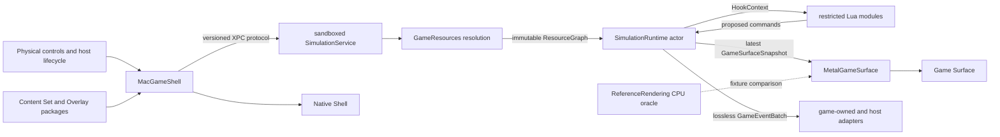

# Native Simulation and Rendering Architecture v1

Status: accepted for implementation; executable validation pending

Decision ticket: [#10 — Choose the native simulation and rendering architecture](https://github.com/odogono/mercenary/issues/10)

Related decisions: [Apple-native stack](adr/0001-use-an-apple-native-stack.md), [research/implementation separation](adr/0002-separate-rom-research-from-implementation.md), [Fidelity Contract](fidelity-contract.md), [Native Shell/Game Surface boundary](adr/0006-separate-the-native-shell-from-the-game-surface.md), [macOS Experience Contract](macos-experience.md), and [Content and State Model](content-state-model.md)

## Purpose and status

This contract defines the production application, simulation, renderer, and resource boundaries for the Initial Release. It preserves Game Semantics independently from the Native Shell, Metal presentation, and Mac Adaptations while leaving concrete content and state to issue #11 and executable fidelity evidence to issue #12.

The architecture is accepted as the implementation baseline. It has been checked statically against the synthetic macOS prototype, the tracked World Geometry Dataset schemas and reports, and the shape of ignored restricted bundles, but it has not been implemented or validated at runtime. It therefore makes no Fidelity Contract conformance claim.

The production target is macOS 14 or newer on Apple silicon. Direct Developer ID distribution is the Initial Release assumption; final signing, notarization, release licensing, exact text and audio reconstruction, and content from *The Second City* remain downstream work. Issue #11 now defines the content, Lua, state, and save boundaries that extend this architecture.

## Governing invariants

- The Game Surface owns world presentation, status, prompts, and gameplay feedback. The Native Shell owns windows, menus, settings, Help, file interaction, and host feedback.
- Game Semantics depend on Semantic Actions, evidence-configured simulation time, an immutable resource graph, and core-owned random state. They do not depend on AppKit, SwiftUI, Metal, controller identity, window state, backing scale, or display cadence.
- Focus loss, minimization, and live resize do not pause or alter simulation. System sleep suspends work and resets the wall-clock scheduling baseline on wake without advancing missed simulation time.
- Display Composition and Accommodations may change presentation only. They cannot change the camera, scene membership, primitive order, Semantic Actions, simulation timing, outcomes, or meaningful future state.
- The renderer may discard stale visual snapshots but no consumer may drop, reorder, duplicate, or infer tick-ordered semantic events from visual differences.
- Invalid resources and an unavailable renderer stop session creation or advancement. The application never substitutes synthetic or partial content, silently changes renderers, or advances headlessly.
- Official and sideloaded Game Semantics use the same restricted Lua path. Sideloaded Mods execute as untrusted inputs inside the sandboxed simulation service and never gain host-framework access.

## Deployment and module boundaries

The production application is an Xcode app with a SwiftUI lifecycle. SwiftUI owns the ordinary Native Shell, while narrow AppKit bridges own `NSWindow` lifecycle details, keyboard event capture, file panels, and an embedded `MTKView`. The app supports one active game session and one Game Surface; Settings, Help, welcome, and host diagnostics are auxiliary Native Shell windows rather than additional sessions.

Platform-neutral code lives in one local Swift package with compiler-enforced target boundaries:

| Target | Responsibility | Allowed dependencies |
| --- | --- | --- |
| `GameResources` | Validate `.mercenarycontent` packages, compose one linear Content Overlay chain, and construct an immutable `ResourceGraph`. | Swift standard library and Foundation only |
| `GameCore` | Own the semantic kernel, deterministic Session State projection, Transition Log, input admission, random streams, command validation, snapshots, events, and state codec. | `GameResources`, Swift standard library, and Foundation only |
| `GameScripting` | Embed pinned Lua, enforce the deterministic language subset and budgets, and translate fixed hooks into proposed commands and module state. | `GameCore`, pinned Lua C sources, Swift standard library, and Foundation only |
| `ReferenceRendering` | Provide the CPU projection/clipping oracle and comparison representations. | `GameCore` only |

The Xcode project adds `SimulationService`, `MetalGameSurface`, `MacGameShell`, and the application composition target. `SimulationService` is a separately sandboxed XPC service that composes `GameResources`, `GameCore`, and `GameScripting`; it receives package/save bytes and semantic commands over a narrow versioned protocol and has no file, network, device, or automation entitlement. `MetalGameSurface` may depend on `GameCore`, `ReferenceRendering`, Metal, and MetalKit. `MacGameShell` may depend on the protocol and rendering targets plus SwiftUI, AppKit, GameController, and other host frameworks, but it cannot link Lua or inspect Session State. No platform-neutral target may import a host or rendering framework.

The dependency direction is one way. The shell and renderer send commands through the composition root; they cannot inspect or mutate the game model.

## Contracted interfaces

These names define responsibilities and ownership for later implementation. Issue #10 does not add their Swift declarations.

### Simulation input and configuration

`SimulationConfiguration` contains a rational tick rate and catch-up/fault parameters sourced from versioned fidelity evidence. No production tick rate, backlog threshold, or tolerance is hard-coded by this contract while the associated Behavior Cases remain provisional.

`SemanticActionTransition` is a post-mapping, post-device-merge press or release carrying a monotonic host timestamp and a strictly increasing admission sequence. The shell resolves Control Profiles, controller selection, simultaneous physical sources, OS key-repeat exclusion, and Command-key reservations before enqueueing it. The core never sees scan codes or controller elements.

For equal timestamps, admission sequence is the stable tie-breaker. The runtime assigns each transition to the first not-yet-executed tick whose admission boundary includes it. Evidence-derived conflict, hold, repeat, and rate-limit rules then operate entirely inside Game Semantics.

### Simulation ownership and output

`SimulationRuntime` is a non-main Swift actor inside `SimulationService` and the exclusive owner of the Session State projection, Transition Log, pending admitted-action queue, per-module random streams, tick and event sequences, and save/restore admission. Fixed Lua phases execute synchronously within the service. A tick stages every command, next module-state value, and random draw, then commits them atomically as `CommittedTransition` records or rolls the entire tick back and suspends.

Each completed tick produces `SimulationOutput` with:

- a `GameSurfaceSnapshot`, an immutable, `Sendable` description of camera state, visible scene membership, ordered primitives, point/wireframe choices, status, prompts, and game-owned feedback needed for presentation; and
- a `GameEventBatch`, stamped with tick and event sequence, for non-visual or one-shot outcomes such as audio cues, save dirtiness, gameplay notifications, and redundant haptic cues.

Snapshots use latest-value delivery: the renderer may replace an unconsumed snapshot with a newer completed one. Event batches use a separate lossless ordered channel with sequence acknowledgement; presentation adapters may not derive them by comparing snapshots. Accommodations are renderer inputs kept separate from snapshots so they cannot feed back into Game Semantics.

`GameStateCodec` owns save availability and conversion between the authoritative Transition Log and the versioned opaque `SaveEnvelope` defined by the [Content and State Model](content-state-model.md). The Native Shell may inspect safe compatibility metadata and atomically move exact envelope bytes through documents and the ten global quick slots, but it cannot encode exposed game fields or initiate storage from inside a simulation tick.

The session seed is injected when a session is created. `GameCore` derives one independent host-backed `math.random`-compatible stream per stable Lua `ModuleID`; streams advance only when their containing tick commits and belong to Session State and saves. Platform random APIs and Lua's private PRNG are not called from state transitions.

## Fixed-step scheduling

The Simulation Runtime advances integer ticks at the rational rate in `SimulationConfiguration`, driven from a monotonic clock rather than the display or wall-calendar time. Presentation callbacks never supply simulation delta time.

When ordinary host scheduling falls behind, the runtime executes only a configured bounded batch per scheduling turn, retains every remaining tick in order, drops intermediate visual snapshots, and records sustained backlog as a timing fault. It never skips a state transition or jumps the simulation clock to match wall time. Issue #12 supplies the evidence-backed batch and fault thresholds and verifies that the policy remains within applicable Acceptance Envelopes.

An explicit pause stops tick advancement through Game Semantics. Focus loss, minimization, and live resize do not. On system sleep the coordinator suspends scheduling; on wake it establishes a fresh monotonic deadline and does not place the slept interval into the catch-up accumulator.

## Rendering pipeline

`MetalGameRenderer` is an `MTKViewDelegate` embedded through the AppKit bridge. `MTKView` uses timed drawing at a requested presentation rate, but the actual rate is selected according to display capability; it is presentation cadence, never game time. See Apple's documentation for [`MTKView`](https://developer.apple.com/documentation/metalkit/mtkview/) and [`preferredFramesPerSecond`](https://developer.apple.com/documentation/metalkit/mtkview/preferredframespersecond).

The CPU side of the snapshot boundary fixes all state-dependent rendering decisions: scene membership, explicit edge and line-operation order, surface/underground selection, altitude and distance detail rules, and point-versus-wireframe choice. Window size, drawable size, Display Composition, and Accommodation settings cannot revisit those decisions.

Metal receives the immutable snapshot and performs camera-relative transforms, projection, clipping, and native-backing-resolution rasterization. Evidence-derived signed integer and fixed-point widths, overflow behavior, division, and rounding remain explicit through clipping; floating-point conversion is allowed only where required to address final drawable coordinates. `ProjectionOracle` performs the same governed math on the CPU and emits a platform-neutral projected/clipped primitive representation for comparison. Issue #12 defines comparison tolerances and fixtures before either path can support a fidelity claim.

There is no visual interpolation between simulation ticks by default. A later Behavior Case or accepted Departure Record must authorize interpolation before it can become a presentation option.

The renderer uses one Metal command queue and at most three in-flight frame resource sets. A set remains immutable until its command buffer completes, and resource reuse uses the narrowest Metal synchronization that resolves the access. Apple's [resource synchronization guidance](https://developer.apple.com/documentation/metal/resource-synchronization) governs the implementation. Render scheduling may choose the newest completed snapshot and omit older frames, but it cannot consume partially published state or alter event delivery.

High contrast, wireframe thickness, status text scale, reduced flashing, and redundant cue presentation are applied after the governed snapshot decisions and remain constrained by the macOS Experience Contract. Stacked and wide Display Compositions arrange Game Surface regions without changing projection or visible content.

If Metal device, pipeline, drawable, or command submission setup fails, the composition root suspends the Simulation Runtime before further advancement and presents a Native Shell diagnostic. There is no onscreen CPU fallback and no headless continuation. Diagnostics identify the failed stage without including Restricted Material, decoded values, bundle contents, or uncleared hashes.

## Resource architecture

`ResourceBundleProvider` eagerly resolves one base `.mercenarycontent` package and its single-parent Content Overlay ancestry before constructing a session. Packages have versioned manifests, payload and asset digests, optional author signatures, Lua/ABI requirements, capabilities, and provenance references. Explicit typed additions, replacements, and removals compose one complete `ResourceGraph`. Validation occurs in this order:

1. validate package containment and declared membership;
2. recognize manifest, payload, property, Lua host-ABI, transition, and save versions;
3. read every declared payload and verify its digest and optional signature;
4. validate payload schemas, Lua source restrictions, integer ranges, typed identities, capabilities, aliases, and traceability;
5. resolve the exact linear ancestry and explicit overlay operations;
6. validate every resolved cross-record reference and initial-state value;
7. preserve provenance and raw-command information required by the World Geometry Dataset contract; and
8. construct one immutable graph and resolved digest or return one typed failure.

Unknown versions, missing payloads, digest mismatches, invalid references, and partial graphs fail closed before a `SimulationRuntime` exists. Runtime diagnostics report safe failure categories only. They do not print raw values, Restricted Material paths, payload excerpts, or Reference Build-specific hashes.

Public synthetic, official restricted, and sideloaded Mod packages implement the same provider contract. Synthetic data supports public tests and examples but is never a production fallback. A future *The Second City* Content Overlay may use the same exact-base composition and audited migration seams, but this architecture includes no expansion content or state-transfer promise.

## Game events and host effects

Game-owned presentation adapters consume `GameEventBatch` values without calling back into the current tick. Gameplay audio and visual cues remain part of the Game Surface experience. Controller haptics may redundantly echo an existing cue, while file errors, controller changes, and renderer/resource failures produce Native Shell feedback. Host effects never become unique gameplay information.

Save, load, close, and quit requests cross the actor boundary as commands. The core determines evidence-derived availability and produces or accepts opaque state bytes; the shell owns panels, slot storage, atomic writes, and destructive-action confirmation. No shell convenience expands legal save/load states or creates hidden game state.

Package import, signature/capability display, exact-digest consent, enable/disable, and installed-version management are Native Shell responsibilities. Consent never widens the XPC sandbox. A modded resolved digest is visibly identified by the Native Shell and cannot inherit the official Fidelity Contract claim.

## Failure and lifecycle matrix

| Scenario | Required behavior |
| --- | --- |
| Focus loss, minimization, or live resize | Continue scheduled Game Semantics; presentation may omit frames. |
| System sleep and wake | Suspend work, retain state, reset the monotonic baseline, and perform no sleep catch-up. |
| Transient scheduling backlog | Execute bounded ordered catch-up, skip no ticks, discard stale snapshots, retain every event, and record sustained fault state. |
| Invalid or unsupported resource bundle | Refuse session creation and show a safe Native Shell diagnostic. |
| Lua trap, budget violation, invalid command/state, or capability breach | Roll back the entire tick and suspend at the last committed transition. |
| XPC simulation-service crash | End the session and lose unsaved progress; offer explicit saves only and create no hidden recovery state. |
| Missing exact package chain during load | Preserve the save and refuse logical-ID substitution or best-effort loading. |
| Metal initialization or submission failure | Suspend the session before further ticks; do not fall back or continue headlessly. |
| Controller disconnect | Release that device's contributions outside the core, retain keyboard input, and deliver passive Native Shell feedback. |
| Dirty load, close, or quit | Ask the core for legal save state and use the Native Shell's Save/Discard/Cancel flow. |

## Static evidence crosswalk

This crosswalk establishes design compatibility, not executable proof.

| Architecture boundary | Public or tracked evidence | Ignored restricted evidence lane | Downstream executable proof |
| --- | --- | --- | --- |
| Native Shell and Semantic Action mapping | The issue #9 synthetic prototype and its input, lifecycle, layout, preference, save-policy, and view tests | None required | Preserve MAS-0001 through MAS-0007 under issue #12. |
| Fixed-step serial runtime | `PrototypeSession` demonstrates only pause/sleep policy; its main-thread 30 Hz timer is explicitly non-production | Reference traces can later supply timing and action ordering without entering the implementation | Compare seeded tick traces and backlog/lifecycle scenarios under issue #12. |
| Resource admission | Tracked geometry schemas, manifests, aggregate reports, and synthetic fixtures define validation expectations | Exact World Geometry Dataset bundles remain ignored and are admitted locally through the same provider contract | Corrupt-bundle tests plus clean synthetic and restricted loads. |
| CPU/GPU rendering split | Tracked geometry research defines ordered edges, transforms, projection, clipping, and detail transitions; synthetic geometry is safe for public comparisons | Ignored reconstructed geometry and comparison captures exercise real ranges and identities | CPU-oracle/Metal primitive and render comparisons under issue #12. |
| Snapshot and event separation | The macOS Experience Contract requires identical information and event ordering across Display Compositions and Accommodations | Reference traces may establish exact one-shot cue ordering | Vary display rate, window state, and Accommodation settings while comparing identical simulation/event traces. |
| Seeded randomness and saves | The Content and State Model defines per-module staged random streams, committed transitions, compaction, exact-bound envelopes, and explicit migrations | Restricted traces and saves may establish legal outcomes and state coverage | Transition replay, random isolation, state round trips, migration, and nondeterministic Acceptance Envelopes under issue #12. |
| Untrusted Mods | The Content and State Model defines package admission, exact-digest consent, restricted Lua, capabilities, transactional commands, and XPC isolation | No Restricted Material is required for malicious synthetic fixtures | Parser/runtime fuzzing, capability and budget attacks, service termination, safe diagnostics, and deterministic mod traces. |

No exact reconstructed payload, comparison capture, decoded value, or restricted hash is made public by this contract. Publication remains governed independently by the [Publication Policy](publication-policy.md).

## Required downstream verification

Implementation and issue #12 must cover at least:

- identical state, snapshot identities, and event sequences for equal resources, configuration, seeds, and Semantic Action transitions;
- stable admission order for simultaneous keyboard/controller contributions and press/hold/release edges;
- invariant simulation traces across display refresh rates, backing scales, window sizes, Display Compositions, and Accommodations;
- ordered no-skip catch-up, dropped intermediate renders, timing-fault reporting, and no system-sleep catch-up;
- schema, digest, version, provenance, reference-integrity, and partial-resource failures that all fail closed;
- CPU-oracle and Metal agreement for transforms, projection, clipping, primitive order, point/wireframe changes, altitude detail, and room membership using public synthetic and local restricted fixtures;
- lossless, exactly ordered event delivery when visual snapshots are replaced;
- seeded random replay and future save/load round trips including random-stream state;
- authoritative Transition Log replay, save compaction, dirty-state acknowledgement, exact-environment rejection, and audited migration;
- deterministic restricted Lua execution, explicit module order, capability enforcement, transactional rollback, and independent per-module random streams;
- malicious package and Lua fixtures plus XPC-crash containment without hidden recovery;
- safe suspension and diagnostics for Metal initialization and command failures; and
- regression of MAS-0001 through MAS-0007 without importing prototype implementation choices.

Until these checks have evidence-backed expectations and pass, the architecture remains accepted for implementation but executable validation and Fidelity Contract conformance remain pending.
