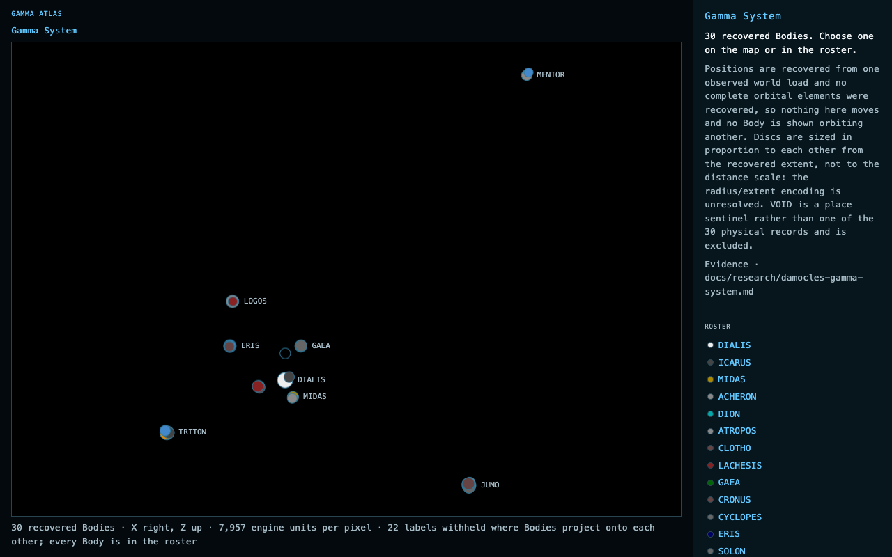
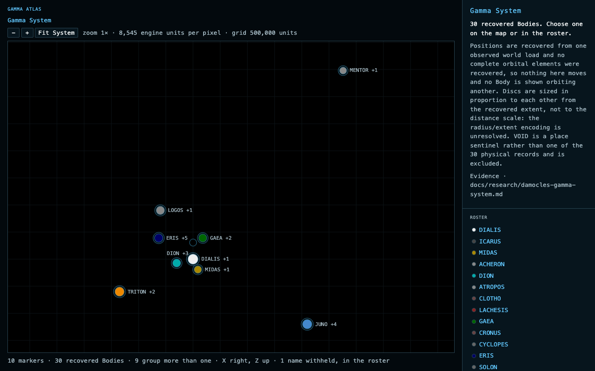
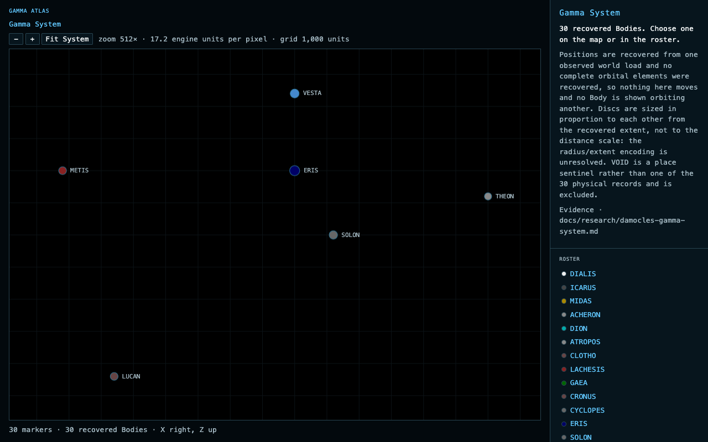
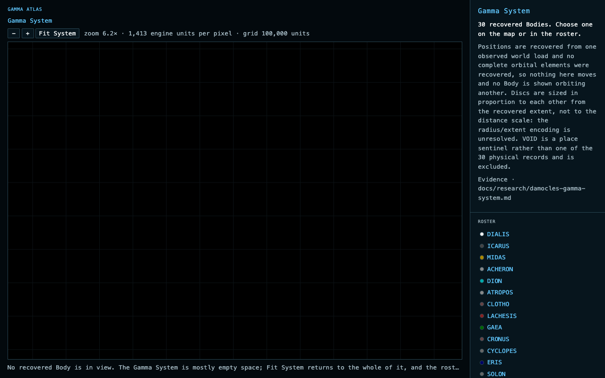
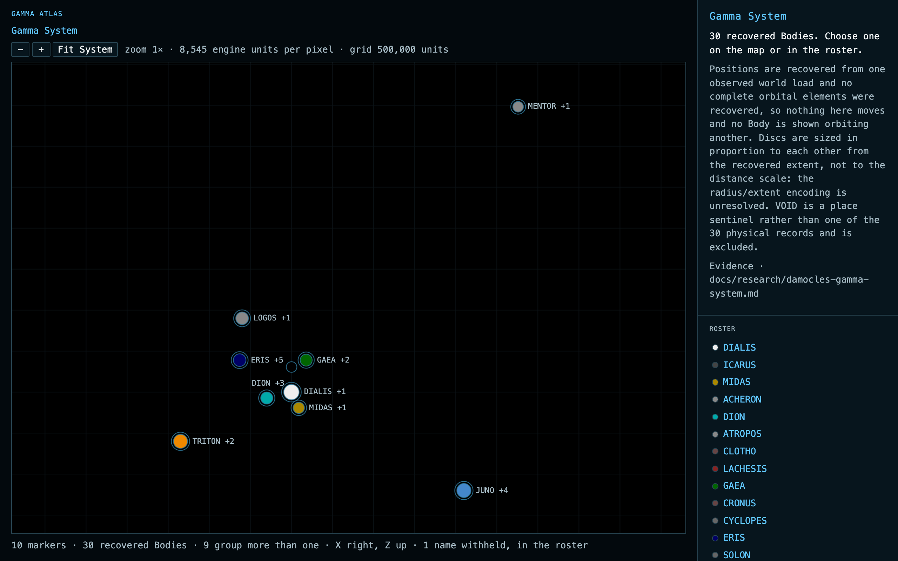

# Atlas System Range camera prototype findings

**Question:** the Atlas System Range landed in #410 as a flat static fit-to-frame projection of all thirty recovered Bodies. It does not pan, does not zoom, draws whole satellite groups as a one-or-two-pixel pile, and can place only nine of the thirty names. Should it get a Google-Maps-style camera with grouped markers, and should that camera come from a third-party map component or from this project's own `mapView.ts`?

**Verdict:** pending owner review in the browser. The evidence below recommends **keeping the project-owned kernel and graduating the camera**, and recommends **against any third-party map library**.

Built in one time-boxed session on 2026-09-21 on branch `prototype/atlas-system-camera`, behind `?camera=1` so `/damocles/atlas` is byte-for-byte what #410 landed and the two are comparable side by side. Prototype material, not production code.

## Should it be a third-party map component? No

1. **Wrong shape of problem.** Leaflet, MapLibre and OpenLayers are geographic tile engines: Web Mercator over lat/lon, raster or vector tiles, latitude clamped near the poles. The Atlas has no tiles and no geodesy. The System Range is a flat Cartesian plane in raw engine units, and the Body Range (#411) is a 4096-cell surface that wraps on *both* axes. Mercator wraps in longitude only, so the torus would have to be fought rather than expressed.
2. **The kernel already exists and is tested.** `web/src/catalogue/mapView.ts` already provides `fitView`, `clampView`, `zoomView` (anchored), `panView`, `project`/`unproject`, `gridStep` and the flood-fill clustering; `web/src/catalogue/map.ts` already implements wheel, drag with a click threshold, arrow-key pan and `+`/`-`/`0`. The whole prototype cost **357 lines of new source** and two additive changes to the kernel. A library would have replaced none of that and added a projection to work around.
3. **Policy.** `web/package.json` has zero runtime dependencies with `knip` enforced. ADR 0019 chose a project-owned renderer over a general engine, and #209 re-declined Three.js on measured evidence. #405 had already settled Canvas 2D plus a DOM overlay for the Atlas.

## Grouping without claiming a Primary

The reader's instinct — "show only the primary planets, then reveal moons on zoom" — cannot be implemented as stated. The planet/moon/`Primary` table is not a recovered field: it is structural inference in `docs/research/damocles-gamma-system.md`, and ADR 0014 keeps it out of `payload/damocles/system.json`.

It does not need to be. **Grouping Bodies that fall within a fixed number of screen pixels of each other reproduces the same structure from the coordinates alone**, and says nothing about any Primary. At the fit camera it yields ten markers:

`DIALIS +1` `MIDAS +1` `DION +3` `GAEA +2` `ERIS +5` `LOGOS +1` `TRITON +2` `JUNO +4` `MENTOR +1` `DAMOCLES`

— the star, the nine planets and the comet, purely geometrically. The marker wears the name of the widest recovered extent among its members, which is the rule `layOutLabels` already used to break label collisions, and a count of the rest. Deliberately a count and not "ERIS system" or "ERIS and its moons".

## Why the threshold is in pixels, not engine units

There is no clean threshold in engine units. Single-linkage merge distances over the thirty recovered X/Z positions:

- widest gap *within* a satellite group: 30,735 (TRITON/THALIA)
- nearest gap *between* two groups: **16,000 (PERSEUS/JASON)**

The between-group gap is *smaller* than the widest within-group gap, so no distance in units both groups the satellites and keeps the groups apart.

In pixels of the current camera there is a wide plateau. At a 900x600 frame the whole System fits a span of 8,883,000 units, or 9,870 units per pixel:

| gap | units | markers |
| --: | ----: | ------: |
| 4–5.9 px | 39,480–58,233 | 11 (DIALIS separates from ICARUS at 58,807 units) |
| **6–19 px** | **59,220–187,530** | **10, one identical partition throughout** |
| 20–21 px | 197,400–207,270 | 9 (DAMOCLES chains into the GAEA group at 193,250 units) |
| 22 px | 217,140 | 8 |

`MARKER_GAP = 14` px sits in the middle of a 3.2x plateau. A pixel threshold is also the honest one: "these two markers would land within fourteen pixels of each other at this Range" is a fact about the drawing, not a claim about the System. And it needs no thresholds per Range and no state per marker — a marker dissolves exactly when its members are far enough apart to be told apart. Measured splitting from the fit: 10, 10, 16, 25, 30 markers at 1x, 2x, 8x, 32x, 64x.

## Two real bugs found on the way

- **`fitView` was not aspect-aware** (`mapView.ts` measured span across the width only). The Catalogue never noticed because `#map` is `aspect-ratio: 1`. On the Atlas's 900x600 stage it clipped MENTOR and JUNO off the map. Fixed additively: `fitView(points, aspect = 1)`, so the Catalogue's behaviour and tests are unchanged.
- **`CLUSTER_GAP = 0.02`** is tuned for surface placements and would merge DIALIS with ICARUS. The Atlas needs its own threshold, so the flood fill was generalised to `clusterAll(points, gap)` and `clusterOf` re-expressed through it.

## What the prototype showed

**The picture is much better.** Thirty overlapping discs with eight visible names become ten separated markers with nine names, a grid for spatial reference, and a ring marking every marker that stands for more than one Body. Clicking a group flies to it and always splits it: clicking `ERIS +5` opens at 512x with all six members named. At DPR 2 everything stays crisp.

**Clustering alone did not fix the labels.** With the existing right-or-left label rule only **six** of the ten markers could be named: the inner System is a knot where DIALIS, DION, MIDAS, ERIS, GAEA and DAMOCLES are all within a label's width of each other. Adding above/below/other-side as fallback placements took it to **nine of ten**, with DAMOCLES the only name withheld. That fallback is behind an opt-in flag on `layOutLabels`, so the static Range's layout is exactly what #410 landed. Worth carrying into production.

**Zooming into the middle shows nothing, and that is true.** The recovered Bodies sit in scattered groups and the System's centroid is empty space, so a wheel zoom anchored at the centre of the frame lands on a blank grid. Google Maps has the same property over ocean. Mitigated here by naming it in the status line — "No recovered Body is in view. The Gamma System is mostly empty space" — plus a Fit System button and the roster. Worth reviewing whether that is enough or whether the camera should prefer the nearest marker.

**The status line had to move.** Writing a scale readout into `#status` from inside the `ResizeObserver` risks the sentence wrapping, shrinking the frame that was just measured. The readout now sits in the toolbar, whose height never changes — the Catalogue's `#map-scale` pattern.

**Markers still overlap at the split moment.** `LARGEST_DISC = 11` means a 22 px disc while the gap is 14 px. Distinguishable in practice, but whether `LARGEST_DISC` should come down is a presentation judgement about the unresolved radius/extent encoding, and belongs in its own issue.

## What it cost

| | |
| --- | --- |
| New source | 182 lines `src/atlas/systemCamera.ts` + 175 lines `src/atlas/camera.ts` |
| Kernel change | `mapView.ts`: `fitView` aspect parameter, `clusterAll`; `clusterOf` re-expressed through it |
| Changed in place | `boot.ts` (camera ownership, gestures, three-way press), `draw.ts` (grid, rings), `system.ts` (`layOutLabels` over label targets, `offscreen`, fallback sides) |
| New tests | 249 lines `test/atlas-camera.test.ts`, 12 cases |
| Runtime dependency | none |
| Landed behaviour | unchanged: all 6 Atlas e2e specs and every #410 unit assertion pass untouched |

`bun test` 1536 pass, `tsc --noEmit`, `eslint`, `knip`, `prettier --check` all clean. The three `catalogue.e2e.ts` failures observed in this session reproduce identically on `main` at `054473e` and are unrelated.

## Evidence

Static Range as #410 landed it — thirty discs, eight visible names, twenty-two withheld:

The camera prototype at the same viewport — ten markers, nine names, grid, group rings:

Clicking `ERIS +5` opens its six members at 512x:

Wheel zoom anchored on the empty centre of the System, with the status line naming it:

At DPR 2:

## If it graduates

1. File a child of #405, "Atlas: System Range camera and Body markers", and comment on #405 that its "System view: a flat static orthographic projection" decision is superseded. **The discrete hop into a Body stands** — only an unambiguous single-Body marker enters a Body; a marker standing for several opens to its members instead, because there is no one Body it could mean.
2. Land it **before #411**, so both Ranges are built on one camera kernel.
3. Production work this prototype deliberately skipped: the `?x=&z=&span=` URL round-trip with a debounced `replaceState`; `panel.ts` copy stating what a marker is; e2e coverage of drag, wheel, buttons and keys; pinch-to-zoom.
4. Note on #411: the clamping seam. The System Range wants today's `clampView` exactly, and the Body Range must not be clamped to a bounded square. When the second behaviour exists, replace the `fit: MapView` first argument of `clampView`/`zoomView`/`panView` with `MapBounds { fit, centre: 'clamp' | 'wrap' }`; the span bound is unconditional either way.
5. Note on #415: it deletes `catalogue/map.ts`, which is why the gesture layer was written fresh rather than retrofitted. Add "delete the duplicated gesture handling" to its checklist.
