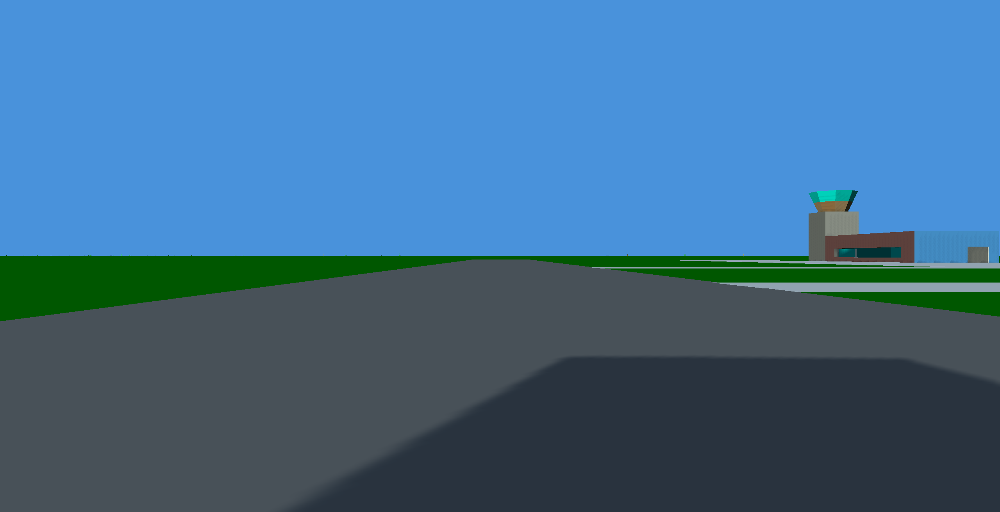
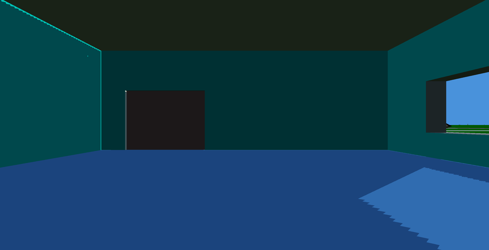
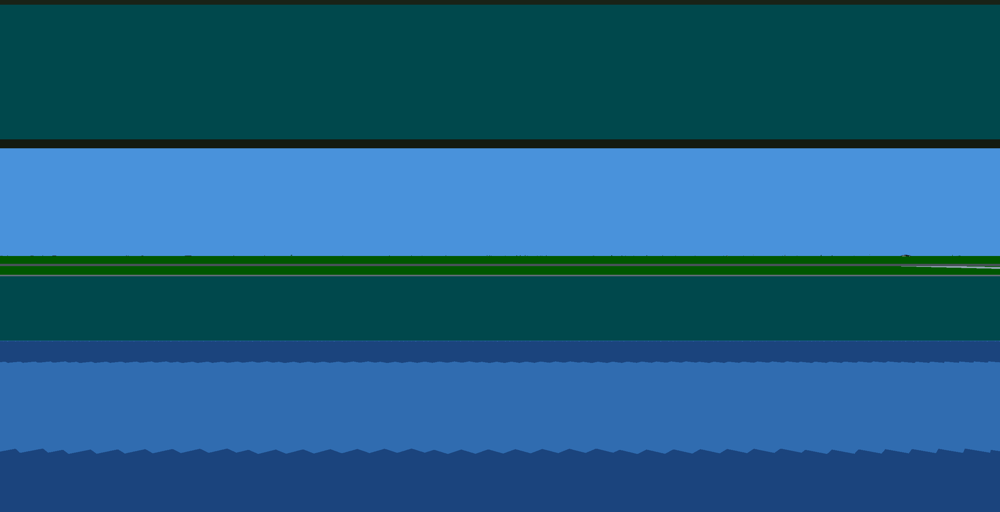

# Damocles Cast Shadow edge: soft against hard (#376)

**Question:** does a hard-edged Cast Shadow suit Damocles's Filled Presentation better than the softened one shipped by #231, and should it become the Enhanced default?

**Verdict:** the hard edge reads as a second flat polygon, which is the look the question hoped for, but at the shipped 2048² cascades its stair-stepping is far coarser than the polygon edges around it and is the first thing the eye lands on. Keep `soft` as the default. `hard` ships as the player's choice on the `SHADOWS` row, and the fallback named in the grilling now applies: if the flat two-level look is wanted by default, the route is geometric shadows or a much finer near cascade, not this sampler.

Captured 2026-09-19 on branch `research/376-cast-shadow-edge` with the shipped switch and the authored Eris sun (`sunDirection` −0.63, 0.31, −0.71; no time of day, #232 is separate). Regenerate with:

```
cd web
CAST_SHADOW_CAPTURE=1 CAST_SHADOW_OUT=$PWD/cast-shadow-frames PORT=5185 \
  bunx playwright test e2e/cast-shadow-capture.e2e.ts
```

Poses are the prototype study's, as offsets from the `eris-surface-87` spaceport origin: start (the document's recovered pose), window-outside (700, 0) facing east, inside-west (1300, 0) facing west, inside-north (1200, 0) facing north. Each is captured `soft` then `hard`, chosen through the console's `set shadows` line, at device pixel ratio 1 and 2: sixteen frames. The four DPR 2 pairs are committed under `docs/frames/issue-376-*`.

## What the switch does

- `soft` averages a 3 × 3 neighbourhood of `textureOffset` compares through a LINEAR `sampler2DShadow`, as before. Each tap is itself bilinear, so the footprint is about four texels wide.
- `hard` makes one `texture()` compare through a NEAREST compare sampler over the same two 2048² depth maps, same bias, same cascades. Only the sampler object and a `hardEdge` uniform change; no program is recompiled and no map is reallocated.
- `off` draws the sun and ambient terms with no shadow at all; Authentic draws nothing of this whatever the row says.

## Measurements

| Check | Result |
|---|---|
| Soft frames against `main` at the same poses, both DPRs | 0.000% of pixels differ by more than 8 levels on all eight frames: the shipped picture is unchanged |
| Distinct colours across the start pose's ground shadow edge (120 × 400 px band, DPR 2) | soft 88, hard 2 |
| Near cascade texel on the ground | 2 × 2048 / 2048 = 2 world units; the eye stands 63 units up, so a texel a few hundred units ahead is tens of pixels wide at DPR 2 |
| Far cascade texel | 32 world units |

## Per pose

**Start.** The apron's own shadow falls toward the viewer across the runway. Soft: a two-to-three-pixel gradient that reads as a shadow. Hard: the same boundary as a two-colour step with a sawtooth of thirty-to-fifty-pixel treads where the edge runs at a grazing angle across the ground. The structure's polygon edges beside it are pixel-crisp, so the shadow edge is visibly the coarser of the two.




**Inside-north.** The west-window beam on the floor. Soft: a clean slanted patch, the roof shadow and the beam meeting in a short gradient. Hard: the patch becomes a staircase along its long edge and its foot; the beam still reads and its contrast is unchanged (the e2e's lit-against-roof-shadowed floor difference stays above 15 luminance levels under `hard`).




**Inside-west.** Looking at the window wall from inside. Soft: a faint horizontal band on the floor. Hard: the same band as a jagged sawtooth across the whole width, the most distracting of the four because the eye is looking along the texel rows.




**Window-outside.** Mostly the wall; the only shadow feature is the lit rim where the roof meets the wall. Both modes show the rim (a #231 leftover the caster dedup did not fully remove); hard turns its gradient into a dashed line of single texels.


## Acne and bias

No new acne appeared under `hard` with the unchanged bias (1.5 texels normal offset, 2 depth units). The lit rim at the wall–roof junction is pre-existing and equally present in both; it is sharper, not larger, when hard.

## Recommendation

- Leave `DEFAULT_CAST_SHADOWS` at `soft`. No change to the shipped Enhanced picture.
- Keep `hard` as an option: it costs nothing, and at DPR 1 on a small window the treads shrink to a few pixels and the flat look is genuinely pleasing.
- If a two-level shadow is wanted by default, the sampler is not the tool. Either a much tighter near cascade (a 512-unit half extent would divide the treads by four, at the cost of a third cascade to cover the room), or geometric shadows: project caster silhouettes along the sun onto the ground plane and draw them as flat polygons through the same layer machinery, which gives edges as crisp as every other edge in the frame. That is the fallback the grilling named, and it is a separate issue.
