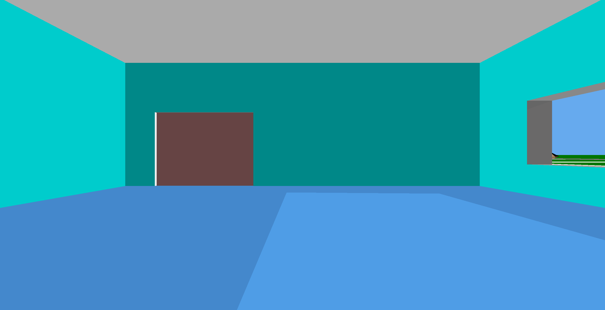
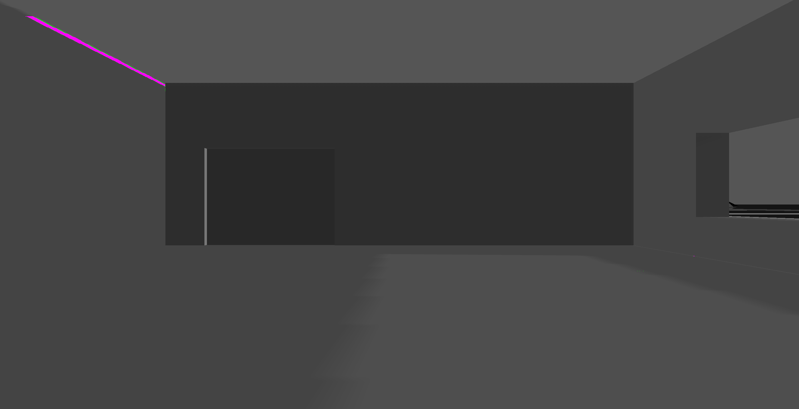
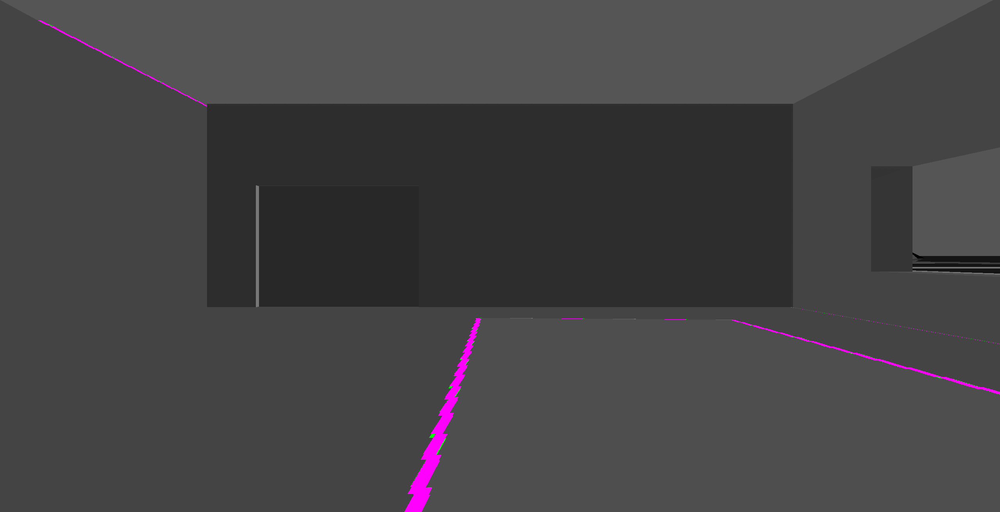
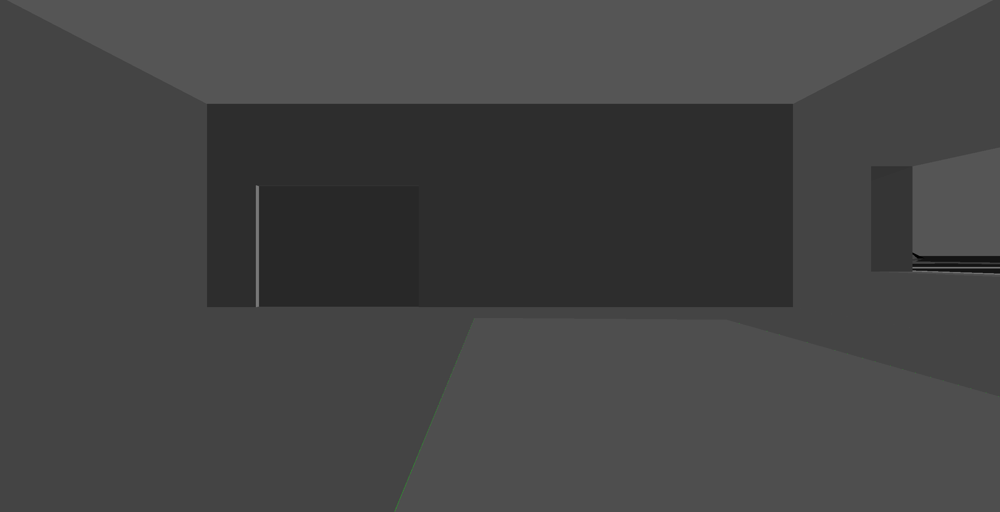
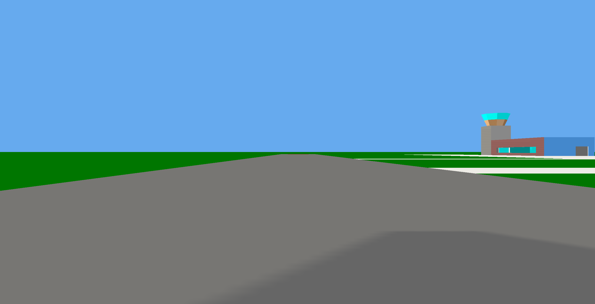
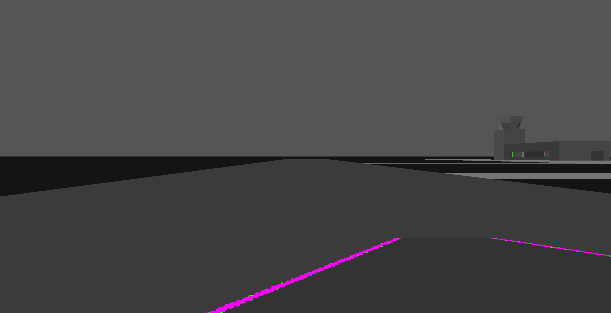
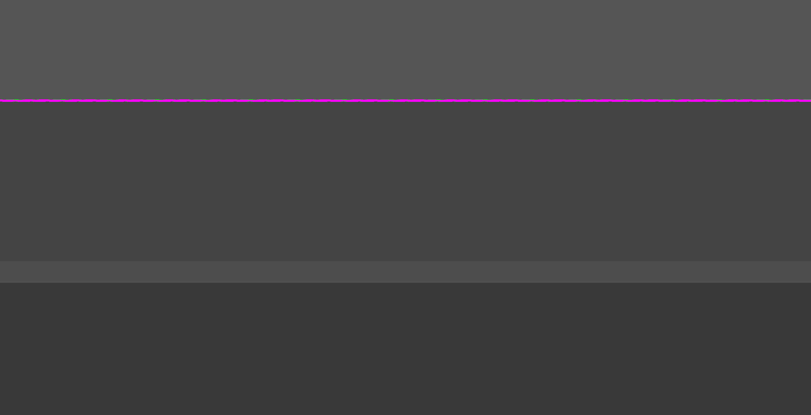
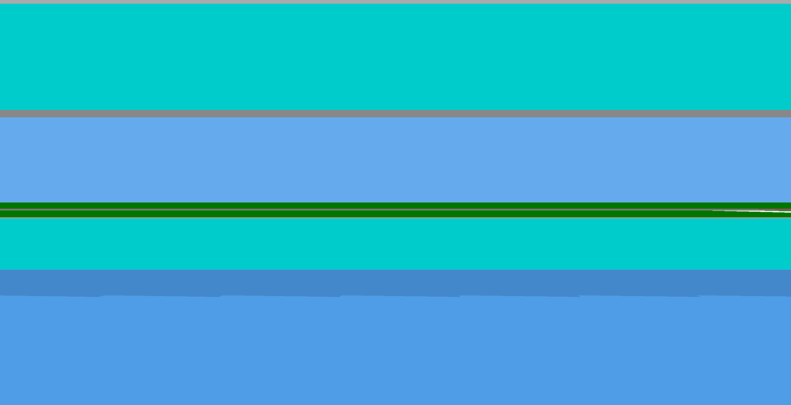
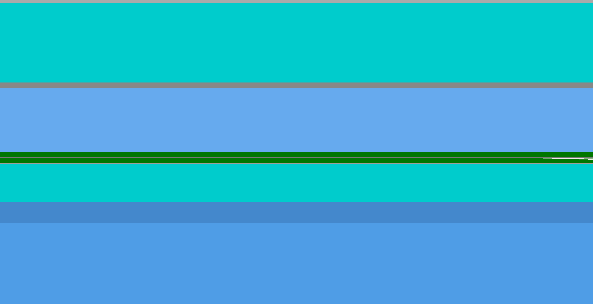
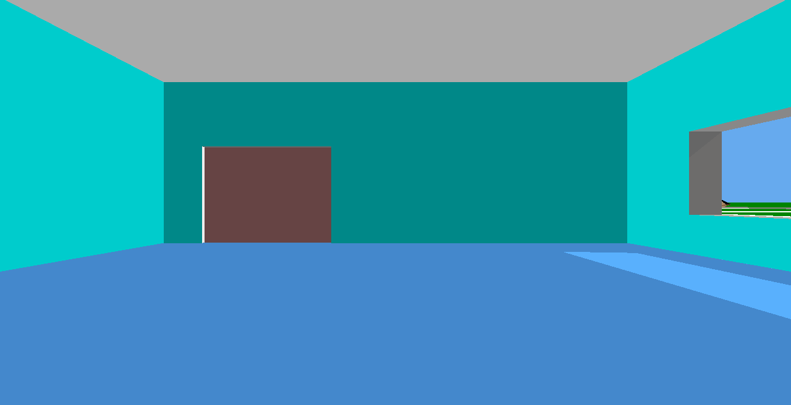

# Damocles Cast Shadow options: maps, volumes and a ray test (#380)

**Question:** since ADR 0066 put Sunlight where the sky draws DIALIS, Cast Shadows shimmer while the player stands still. Their edges were already coarser than the polygon edges beside them (#376). Which technique gives a Cast Shadow edge that is as crisp as a polygon edge and holds still while DIALIS moves?

**Verdict:** a per-fragment ray test against the caster triangles. It and stencil shadow volumes both draw exact edges that never flicker, and both remove the lit rim left over from #231, and on every captured frame the two agree. The ray test is the cheaper of the two (2.2–4.8 ms of GPU time against 4.2–7.3 ms at device pixel ratio 2). It is also a single pass with no stencil buffer, and it leaves the layer machinery alone. Holding the sun between 1/1024-turn steps stops the shimmer of the shadow maps, but it keeps their stair-steps and makes every edge jump once a step. It does not answer the question. This replaces the method #380 chose.

Captured 2026-10-03 on branch `research/380-shadow-options` at #376's four poses and Body turn `$02800000` (DIALIS about 19° up in the west), on an Apple M1 Pro through ANGLE's Metal backend.

## Why the maps shimmer

`lightMatrix` (`web/src/rendering/lighting.ts`) snaps the light window to whole texels so that walking does not slide the grid. The snap is the eye's offset along the light's x and y axes, taken modulo one texel, which anchors the grid's lines at the world origin. The spaceport eye stands about 4.7 million units from that origin. Each 50 Hz step the Body turns `$141` of `$04000000`, about 3.0 × 10⁻⁵ radians, so the grid lines near the eye move by roughly 140 units per step. A near-cascade texel is 2 units across. Each frame therefore lands the grid at an effectively random sub-texel offset, and every edge is resampled from scratch. The slowest console `rate`, 1/16, still moves the grid 9 units a step. This is not the slow crawl ADR 0066 anticipated: it is noise at the frame rate.

`soft` hides most of it in its blur, but not where the blur is thin. Its flicker sits almost entirely on the lit rim at the wall–roof junction (the `window-outside` and `inside-north` maps below). `hard` flickers along every edge.

## The candidates

All of them are behind the console's `set shadows` line and the settings page's `SHADOWS` row as prototype values.

- **`stepped`**: the shipped hard map, with Sunlight's direction held until DIALIS has moved one engine step of 1/1024 turn (`steppedSun` in `web/src/damocles/lighting.ts`). At rate 1 that is about every 4 seconds of a roughly 70-minute Eris day.
- **`volume`**: stencil shadow volumes as #380 describes them. Each caster triangle is turned to face the sun and swept 16,384 units away from it into a closed prism (`shadowVolumeVertices` in `web/src/rendering/exactShadows.ts`). The prisms are counted depth-fail into the stencil. The frame is drawn ambient-only, and then repeated with full Sunlight under `EQUAL` depth where the count is zero. Each prism's front cap keeps its caster's own plane bit for bit, so a lit face ties with its cap and stays lit. The volume vertex shader clips at the near plane only.
- **`exact`**: a ray test. Under an orthographic sun, the ray from a fragment toward DIALIS is a single point in the light's plane. The casters are projected into light space once a frame and listed in a 512 × 512 grid of 32-unit cells within 8,192 units of the eye (`casterGrid`). The fragment shader tests only its own cell's triangles in two dimensions, then compares depth along the light. A triangle beyond the fragment by more than 0.05 units plus 2 parts in 100,000 of the fragment's distance shadows it. Edge points count for both triangles that share them, so no pinhole opens along a seam.

Both exact candidates take their casters from the structures alone. The Body's surface, the island fills and the ground records lie flat on the ground and cannot shadow anything above them. The maps keep every caster, as shipped.

## Measurements

The temporal mode takes eight back-to-back frames per edge at console `rate 0.0625`, so DIALIS barely moves between them. A pixel that changes by more than 8 levels in two or more frame pairs is counted as flicker, since a sliding edge changes a pixel once. Pixels that changed exactly once are counted as moved. The values are the percentage of the frame below the message strip.

| Pose, DPR 2 | soft flicker | hard flicker | stepped flicker | volume flicker | exact flicker |
|---|---|---|---|---|---|
| start | 0.020 | 0.475 | 0 | 0 | 0 |
| window-outside | 0.552 | 0.206 | 0 | 0 | 0 |
| inside-west | 0 | 0.329 | 0 | 0 | 0 |
| inside-north | 0.131 | 0.615 | 0 | 0 | 0 |

The DPR 1 figures are the same to within a few hundredths. `stepped` reads zero only because no step fell inside eight frames. At each step it resamples every edge once, as `hard` does every frame.

Each figure is the median GPU time of the whole Enhanced frame over 120 frames, from `EXT_disjoint_timer_query_webgl2`:

| Pose | soft DPR 1 / 2 | hard | volume | exact |
|---|---|---|---|---|
| start | 1.53 / 3.22 ms | 1.25 / 2.16 | 1.43 / 4.18 | 0.95 / 2.16 |
| window-outside | 1.89 / 3.58 | 1.21 / 2.29 | 3.19 / 7.29 | 1.61 / 4.82 |
| inside-west | 1.56 / 3.05 | 1.35 / 2.30 | 1.70 / 5.45 | 1.09 / 2.68 |
| inside-north | 1.74 / 3.27 | 1.35 / 2.53 | 2.66 / 6.78 | 1.32 / 3.64 |

`exact` costs less than `soft` at `start` and `inside-west`, 0.4 ms more at `inside-north`, and 1.2 ms more at `window-outside`, where the camera faces a wall a few units away and every pixel tests the cell under it. The grid build takes about 1 ms of CPU per frame for 360–400 casters, and no cell lists more than 48 triangles. `volume` costs the most because of its large far caps and its second colour pass.

Soft and hard frames on this branch, compared with `main` at the same poses below the console overlay, differ on at most 0.02% (soft) and 0.38% (hard) of pixels. That is the noise itself: two captures on `main` differ by as much.

## Per pose

**Inside-north.** The west-window beam on the floor. `soft` gives a blurred patch with a staircase along its long edge and a lit rim along the wall's top. Both exact candidates give a clean four-sided patch with no rim, and they agree pixel for pixel.





Flicker over eight frames (magenta: changed back and forth; green: changed once):





**Start.** The apron's shadow across the runway. `soft` draws a wavy outline that the geometry does not have. The exact candidates draw two straight edges and a corner.






**Window-outside.** The `soft` and `hard` maps both draw the lit rim where the roof meets the wall, and under `soft` it is the main source of flicker in the frame. The exact candidates draw none, because the roof shadows the wall right up to the junction.




**Inside-west.** The floor band along the window wall becomes a straight two-level step.




**Low sun.** At Body turn `$02B80000`, a few degrees above the horizon, the beam stretches across the hall. The exact candidates still agree.



## Costs that do not show in the frames

- **`volume`** needs a stencil buffer on the context. It also needs a second colour pass that repeats `drawLayers` under `EQUAL` depth, which works only because every pass computes the same per-fragment plane depth. The volume program needs a vertex shader that clips at the near plane alone, and the prism count is eight triangles per caster. A shadow longer than the 16,384-unit sweep is cut off. Each prism must stay watertight, or a pixel's count goes wrong for the rest of the frame.
- **`exact`** needs three tables uploaded each frame and five sampler units kept apart. A receiver more than 8,192 units from the eye in the light's plane is lit. That is beyond any Floor or apron reach, but a long shadow seen from the air would be cut at the window. The self-shadow epsilon has a fixed part and a part that grows with distance. It has held at every pose and at a low sun, but it is a tuning constant. A cell crowded with triangles costs its pixels directly. The worst seen here is 48.
- **`stepped`** costs nothing, but it does not stop the stair-steps or the once-a-step jump. Anchoring the snap near the eye instead of at the world origin would turn the per-frame noise into a slow crawl (about 0.03 units per step a kilometre from the anchor). The edge would still stair-step.

## Decision

The owner chose to replace both maps with the ray test ([ADR 0069](../adr/0069-ray-test-damocles-cast-shadows-against-their-casters.md)). The `SHADOWS` row is now OFF / ON, and a stored `soft` or `hard` reads as ON. The maps, `lightMatrix`, and the `stepped` and `volume` prototypes have been removed. They can be read at commit `90209c76` on this branch.

ADR 0066's last consequence (shadow edges can crawl, so step the light) no longer applies: an exact edge slides with the sun, as the polygon edges beside it do.

## Reproduce

```
cd web
CAST_SHADOW_CAPTURE=1 CAST_SHADOW_GPU=1 CAST_SHADOW_OUT=$PWD/cast-shadow-frames \
  CAST_SHADOW_TEMPORAL=8 CAST_SHADOW_TIMING=120 PORT=5191 \
  bunx playwright test e2e/cast-shadow-capture.e2e.ts
```

The prototypes were measured at commit `90209c76`, where `CAST_SHADOW_EDGES` accepted `soft`, `hard`, `stepped`, `volume` and `exact`. Since the decision it accepts `off` and `on`. `CAST_SHADOW_GPU=1` asks ANGLE for the Metal GPU. Without it, headless Chromium draws with SwiftShader on the CPU, where `exact` takes seconds a frame and no GPU timer exists. `CAST_SHADOW_EDGES`, `CAST_SHADOW_DPRS` and `CAST_SHADOW_TURN` narrow the matrix. Flicker lands in `flicker.tsv` (flickered %, moved %), and GPU milliseconds land in `timing.tsv`.
