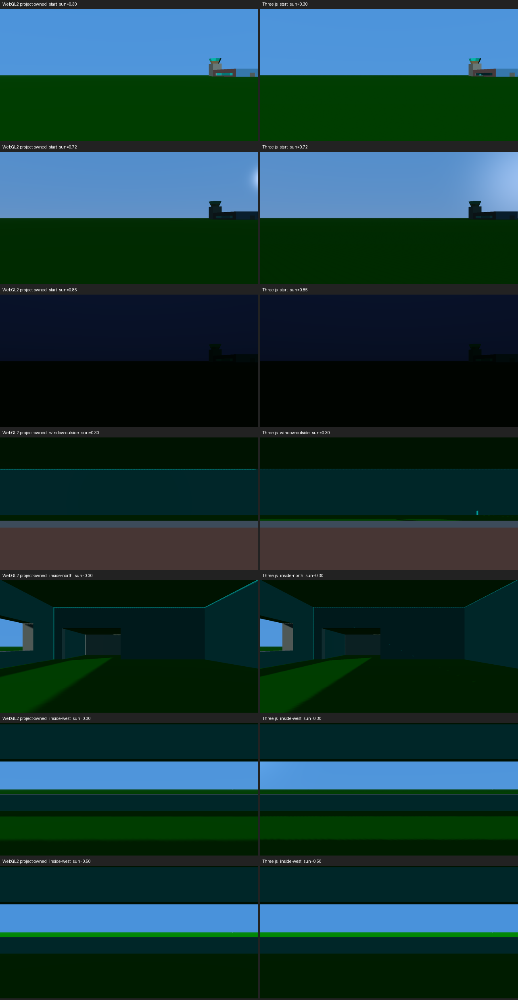
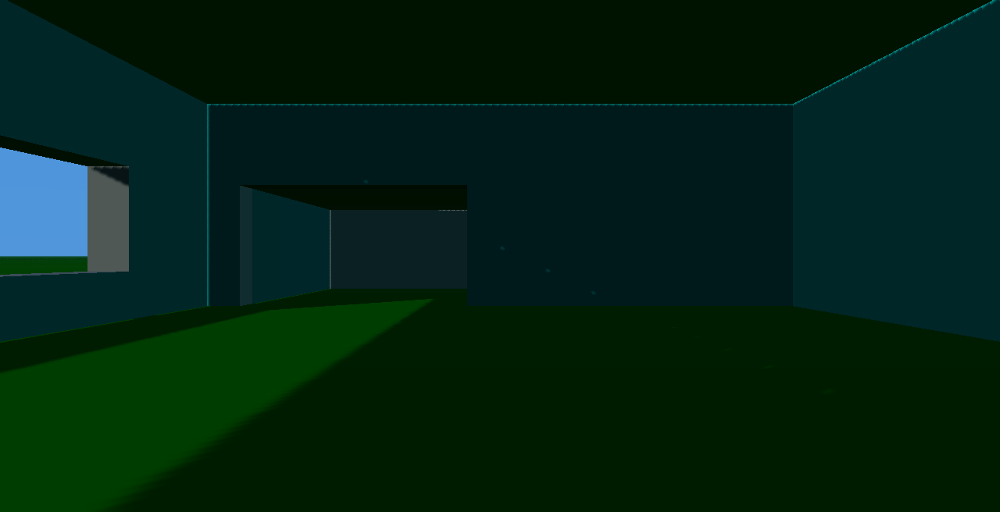
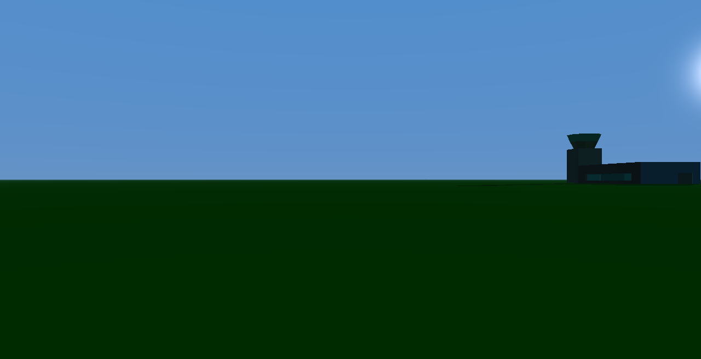
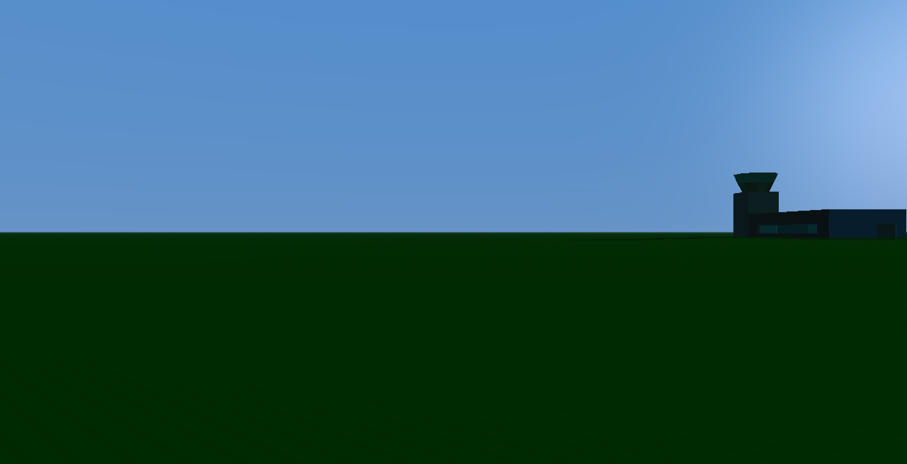
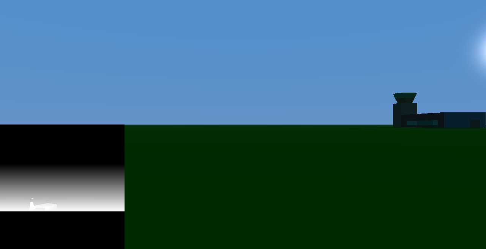

# Damocles lighting prototype findings (#209)

**Question:** should the Damocles on-foot renderer at `/damocles` adopt Three.js to carry an Enhanced-preset lighting roadmap (structure shadows including sunlight through the spaceport window, soft PCF shadows with ambient light, sun altitude and day-night colour, sky and haze), or can the project-owned WebGL2 renderer carry it at acceptable cost?

**Verdict:** pending the owner's side-by-side review (ADR 0011). The prototypes' recommendation is below; the owner records the decision on #209.

Both prototypes were built in one time-boxed session on 2026-09-14 from a shared base, consume the same `ErisFramePlan`, and light with the same authored colour ramps, so the frames differ only in what each renderer does with them. They are primary-source prototype material, not production code, preserved only on these branches:

- [`prototype/209-lighting-base`](https://github.com/odogono/mercenary/tree/7220747c1f0947382da18908d999ed8394756702): shared lighting inputs, query flags, capture matrix.
- [`prototype/209-threejs`](https://github.com/odogono/mercenary/tree/4a4194c0e93c42b53c81f4b9b71db314e45fe427): Three.js r0.186 as a draw wrapper over the plan.
- [`prototype/209-webgl-lighting`](https://github.com/odogono/mercenary/tree/7fecb022f58fad02d10e45e0f13feec44ffce98f): the project-owned WebGL2 renderer extended in place.

## Headline

The two renderers produce near-identical pictures. Over the 20-frame capture matrix, fewer than 2% of pixels differ by more than 8 levels on every frame except the low-sun exterior, where the sun glow renders differently (8.5%). Sunlight falls through the west window onto the interior floor in both; the roof shadows the rest of the room in both; both go dark at night. Picture quality is therefore not what decides #209. Cost, dependency and where the remaining problems live are.

## What each side cost

| | Three.js | Project-owned WebGL2 |
|---|---|---|
| New code | 371 lines `threeRenderer.ts` + 8 lines import map + 17 in boot | 482 lines added to `renderer.ts` + 17 in boot |
| Runtime dependency | `three` 0.186 + `@types/three`; 693 KB unminified fetched by the browser via an import map from `node_modules` (also for Authentic frames) | none |
| Serving change | import map in `damocles.html`; relies on `serve.ts` happening to serve everything under `web/`, which must not survive | none |
| Files outside `web/src/damocles/` | `damocles.html`, `package.json`, `bun.lock` | none |
| Authentic parity with `main` | 0.23 to 0.61% of pixels differ, edge rasterisation only, after forcing linear output and disabling colour management globally | byte-identical (`cmp` clean on all four poses) |
| CPU submit time, Authentic | 0.14 to 0.17 ms | 0.08 to 0.09 ms |
| CPU submit time, Enhanced | 0.53 to 0.92 ms | 0.10 to 0.14 ms |
| Shadow coverage | three cascades (CSM addon), 4096 squared each, to 24,000 units | one 2048 squared map, plus or minus 2048 units around the viewer, depth range 16,384 |

GPU time was not measured on either side; both numbers are wall time around the submit call.

## Selected recipe (common to both)

- Face normals from screen derivatives (WebGL2) or per-triangle in JS (Three.js). No vertex format change; `planErisFrame` and `selection.ts` untouched.
- The shadow caster set is the drawn set. Because the window is an opening by omission, the depth pass admits sun through it with no aperture logic.
- Light basis world-fixed, rotated into the camera-relative view space through the project `Camera`, so no handedness was re-derived.
- Sun by a debug time of day along the authored azimuth; colour ramps for sun, zenith, horizon and hemisphere ambient shared from `lighting.ts`.
- Exponential fog toward the horizon colour; a sky gradient with a sun disc drawn first with depth writes off.

## Where the problems live

- **Both:** the shared ramps run dark. Vertical walls at zenith and interiors at any hour sit near black, and the ground shadow contrast at low sun is small. This is a ramp property to retune, not a renderer property.
- **Both:** a thin lit rim where interior walls meet the roof at low sun. Three.js attributes it to PCF taps straddling the coincident reversed twin of double-sided faces; WebGL2 attributes it to texel footprint at grazing roof angles, halved by halving the texel. Neither fixed it by bias alone. Filtering the reversed duplicates out of the depth pass is the likely fix on either side.
- **Three.js:** a single orthographic shadow frustum missed the spaceport at the 7,650-unit start pose, forcing the CSM addon, which overwrites Three's global lighting shader chunks on construction. The exponential fog chunk had to be patched through `onBeforeCompile` to match the shared formula. Colour management had to be disabled page-wide for Authentic parity. Cascade centres snap in view space, so shadow edges will crawl while walking.
- **Three.js:** at the start pose with a low west sun, the spaceport's cyan window band renders dark where WebGL2 lights it. Undiagnosed; the geometry is identical, so it is a shading or self-shadow difference.
- **WebGL2:** casters more than 16,384 units toward the sun leave the light box, and receivers beyond 2,048 units from the viewer are unshadowed. Cascades would be the next 100 to 150 lines. Faint diagonal PCF striping remains inside the lit floor patch at dawn. Texel snapping is implemented but was not walked.

## Recommendation

Keep the project-owned renderer. The prototypes show the full lighting roadmap costs about 500 lines on the project side with no dependency, no serving change, byte-identical Authentic output and a fifth of the submit time, and produces the same pictures. Three.js saved no lines here, because the plan is already camera-relative flat triangles and every Three.js convenience had to be bent to it: cascades, fog formula, colour management, winding via a mirrored group. The remaining WebGL2 gaps (cascades, rim fix) are bounded work that Three.js also needed and did not fully solve. The Three.js path becomes worth revisiting only if the roadmap grows past lighting into materials, post-processing or a scene the plan no longer describes.

If the owner prefers Three.js after review, ADR 0045 must name the serving decision (vendored module plus import map, not `node_modules` by accident), the page-wide colour management setting, and keep ADR 0019's line-list stance for Targ.

## Evidence












The full 20-frame matrix per renderer is regenerated on each branch with:

```
cd web
LIGHTING_COMPARE=1 LIGHTING_RENDERER=<webgl|three> LIGHTING_OUT=$PWD/lighting-compare/<name> PORT=5185 bunx playwright test e2e/lighting-compare.e2e.ts
```

Poses are offsets from the `eris-surface-87` origin: start (recovered pose), window-outside (700, 0) facing east, inside-west (1300, 0) facing west, inside-north (1200, 0) facing north. Sun times 0.30 dawn, 0.50 zenith, 0.72 low sun from the opposite bearing, 0.85 night. At 0.50 a vertical west window cannot light the floor, so the whole room is correctly in shadow on both sides; 0.30 is the telling frame.

## Checks exercised

- `bun test` (1,267 tests), `bun run typecheck`, `bun run lint`, `bun run unused` green on all three branches.
- `e2e/damocles.e2e.ts` 7 of 7 on all three branches.
- The plain `/damocles` route loads no prototype code on either branch: Three.js is a dynamic import behind `?renderer=three`; the WebGL2 additions sit behind an option the default construction never sets.
- Not exercised: GPU timing, walking for shadow shimmer, devices without 4096 or 2048 squared depth textures, the Enhanced path under the fake-GL unit tests.

No renderer, lighting, sky or shadow code moves to `main` from this study.
