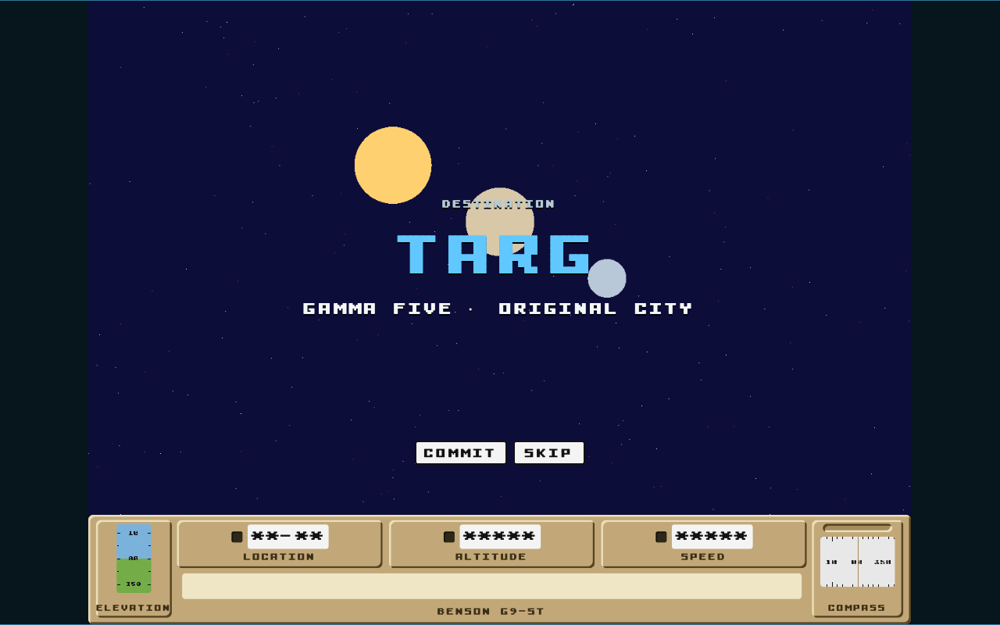
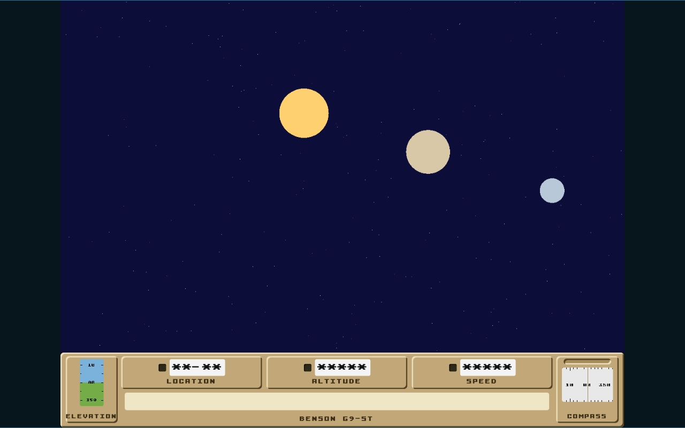
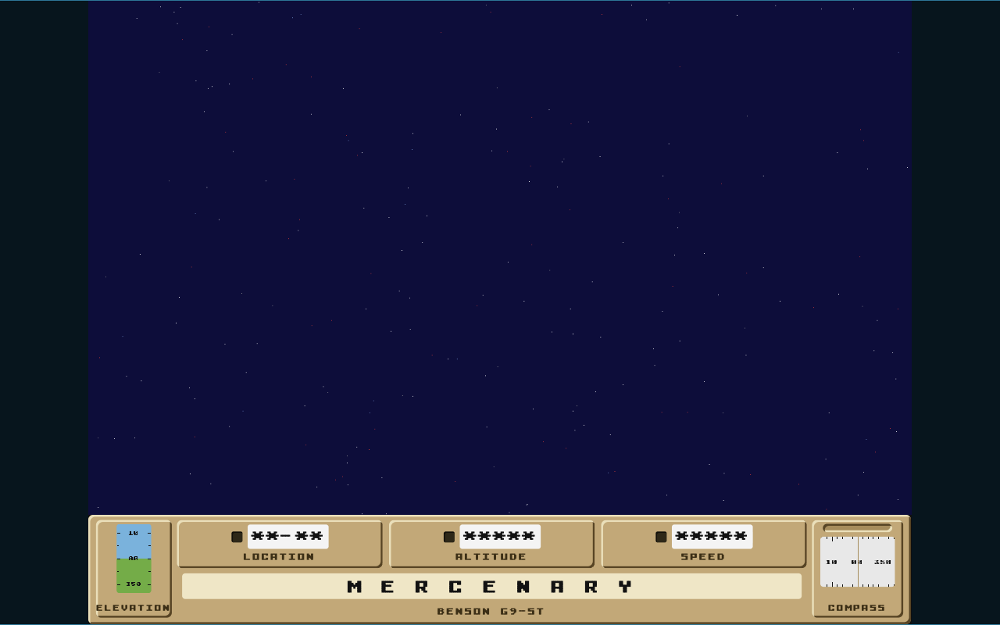

# Departure opening prototype findings

**Question:** can a keyboard-and-button Destination carousel hand into a short Targ flyby and then the unchanged Arrival without a perceived cut?

**Verdict:** yes, with the Benson Panel present throughout, a critically damped 320 ms carousel snap, and a ten-second committed journey. The Departure converges on the current planet-free Arrival Field and hands over before `titleCard`; `M E R C E N A R Y` remains the Arrival's first beat and the Arrival owns the sole planet approach.

The runnable study and its temporary tests are preserved only in the [`prototype/160-departure-opening` prototype commit](https://github.com/odogono/mercenary/tree/a0d9e9b60ef9b68bd0fcf82d0c1784e12cbf2e37). They are primary-source prototype material, not production code.

## Selected recipe

- **One-entry release:** show Targ and Commit/Skip; hide previous and next rather than implying unavailable Destinations.
- **Later carousel:** wrap continuously. Direction input retargets immediately; commit completes the current target snap before starting the journey. Keyboard arrows and visible previous/next/commit buttons share that state. A focused button retains native Space activation; explicit Skip performs commit-current plus fast-forward.
- **Snap:** critically damped spring, normalized and clamped without overshoot, settling in 320 ms. The 180 ms variant read as a twitch; 500 ms felt delayed. At the same duration, the ease-out tween front-loaded too much travel and made reversal feel mechanical.
- **Journey:** ten seconds, divided into 3.0 seconds of interstellar departure, 4.0 seconds of Targ-system flyby, and 3.0 seconds of convergence. Six seconds left too little recognition and breathing room; sixteen made the already-long opening linger.
- **Bodies:** exactly Targ's sun and two moons, carrying the Targ Orrery's colours and relative angular sizes. Their screen spacing and flyby path are prototype choreography, not astronomy or a public simulation contract.
- **Shell:** retain the Benson Panel with asterisk readouts and a blank message field until handover. Canvas-only presentation failed because restoring the panel resized the authored frame at the title card and read as a cut.
- **Direct start:** a Title path begins at the same committed journey with the carousel omitted. The prototype simulated this entry without implementing routing.
- **Reduced motion:** use a four-second version with 0.6 units of field drift rather than the primary treatment's 8, keeping the 30/40/30 division and one brief sun/two-moon tableau. Select it from `prefers-reduced-motion`, with no change to the existing Arrival; full-Arrival reduced motion remains separate work.
- **Sound:** none was used or selected. The verdict covers motion, controls, panel composition and the visual seam only.

## Handover invariant

For every viewport size, the final Departure plan is the direct result of `arrivalFieldPlan({ drift: 0, planet: 0 }, size)`, which is also the first frame of the unchanged Arrival. Equality covers clear colour, batch order and modes, colours, all star vertices, overlays, line/point counts and viewport size. The disposable test compared the complete `FramePlan`, not a screenshot approximation.

The full-speed pass showed no star teleport, axis jump, colour flash, duplicate frame, lost selection or unexplained pause at the boundary. The static title hold reads as the Arrival beginning, not the journey stopping.

## Evidence

The [60 fps review video](https://github.com/odogono/mercenary/raw/ccdbcdf7a2df102a7e8c671437072ed165204798/docs/prototype-evidence/issue-160-departure-review.webm) records the selected ten-second, panel-visible treatment through the title-card handover.

## Checks exercised

- Truthful one-entry mode and a debug-only circular three-marker calibration mode with abstract labels.
- Spring and ease-out snap models at 180, 320 and 500 ms, including wrap, reversal during motion and commit before settling.
- Six-, ten- and sixteen-second primary journeys; panel-visible and canvas-only composition at the selected timing.
- Root-carousel and direct-start entry, explicit Skip, native Space on a focused button, and four-second reduced motion.
- Browser widths of 320, 768, 1024 and 1440 pixels; keyboard focus; a scoped axe-core pass with no violations; clean console and page-error checks after the final Skip path.
- `bun run typecheck`, `bun run lint`, and all 1,134 browser implementation tests on the throwaway branch.

No Departure runtime, routing, payload-selection, Save, Session Resume or Session State code moves to the implementation branch from this study.
